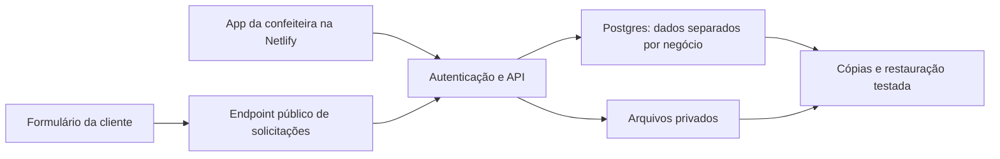

# Doce Agenda — análise e plano das próximas implementações

**Data:** 01/10/2026. **Estado:** incremento técnico A/B implementado e publicado no piloto; validação com confeiteiras ainda pendente. **Base:** texto de pesquisa fornecido pelo usuário, leitura do código e documentação técnica oficial. Nenhuma contratação ou contato com confeiteiras foi realizado.

## 1. Parecer sobre o texto

A direção é coerente: aprofundar o fluxo da encomenda, em vez de adicionar um conjunto grande de funções sem validar uso. A melhor hipótese é ajudar a conferir o combinado e a carga de trabalho antes de confirmar uma encomenda. Isso combina com a agenda, os pagamentos e o histórico já existentes.

O texto acerta ao reconhecer a concorrência e os limites da pesquisa qualitativa. Porém, ainda não sustenta que capacidade seja a maior dor, que o público pagaria por isso ou que esses recursos sejam um diferencial exclusivo. Sem links, datas e contexto dos relatos, não é possível conferir a pesquisa original. Os relatos descritos são **indícios fornecidos**, não evidências verificadas nesta análise.

| Afirmação do texto | Leitura crítica | Consequência para o plano |
| --- | --- | --- |
| Há pedidos por dias bloqueados e limite de produção | Indício direto de uma necessidade de algumas pessoas; falta saber frequência e impacto | Testar capacidade cedo, começando com regras simples |
| Campos de personalização reduzem erros | Hipótese plausível; campos em excesso também tornam o cadastro difícil | Começar com um modelo de bolo personalizado e observar quais campos fazem falta |
| Ferramentas oferecem listas de compras e produção | Evidência de oferta relatada, não de demanda comprovada | Fazer primeiro tarefas editáveis; compras automáticas dependem de receitas estruturadas |
| Sincronização é essencial para uso real | Avaliação razoável para um serviço compartilhado; uso local também pode funcionar com recuperação adequada | Tornar recuperação e integridade prioridade; conta na nuvem antecede o formulário público |
| Validar com 8–12 confeiteiras | Boa meta exploratória, sem representatividade estatística | Começar pela amiga e mais 2–3 participantes; ampliar após corrigir os primeiros problemas |

**Posicionamento proposto, ainda a validar:** “Confira os detalhes de cada encomenda e o espaço na sua produção antes de confirmar.” Evitar prometer que o produto impedirá todo erro ou aceitará automaticamente qualquer pedido.

## 2. O que existe hoje

O piloto público está em https://doce-agenda-piloto.netlify.app. É uma aplicação HTML/CSS/JavaScript, sem React. Ela registra pedidos e próximos passos, mostra Hoje/Pedidos/Semana, mantém histórico, registra pagamentos Informado/Conferido, calcula saldo e copia um resumo textual para envio manual no WhatsApp. Desde 01/10/2026 também tem regras internas de disponibilidade, campos configuráveis para bolos e restauração de backup.

Há dois armazenamentos diferentes: o servidor local Node grava `web/data/state.json`; o site Netlify é estático e usa `localStorage` no navegador. A API aparente do site é simulada por `browser-store.js`, não é um serviço compartilhado. Um formulário aberto no celular da cliente **não conseguiria alimentar a agenda da confeiteira com essa arquitetura**.

Já existem campos livres para detalhes, contato, entrega, próxima ação e alteração pendente. O piloto agora fecha dias e limita confirmações por data, com exceções justificadas; o modelo de bolo permite configurar seis campos fixos; Backup exporta e Restaurar importa JSON v1 após validação. Ainda não existem foto, formulário externo, conta, sincronização, tarefas de produção, receitas ou estoque.

## 3. Ordem recomendada

Prioridade de aprendizado e ordem de construção são diferentes: capacidade deve ser investigada já; a infraestrutura compartilhada precisa estar pronta antes de receber pedidos externos.

| Etapa | Entrega | Dependência | Complexidade relativa |
| --- | --- | --- | --- |
| A | Recuperação do piloto e validação da rotina | Estado atual | Baixa a média |
| B | Disponibilidade interna e detalhes estruturados | A; hipóteses observadas | Média |
| C | Conta, banco compartilhado, migração e recuperação | Regras estabilizadas de A/B | Alta |
| D | Link de solicitação de encomenda, com foto | C e validação de capacidade no servidor | Alta |
| E | Checklist de produção por data | Pedidos confirmados estruturados | Média |
| F | Receitas e lista de compras; estoque depois | E e unidades de insumos definidas | Alta |

Essas faixas comparam escopo, não representam orçamento ou prazo contratado. Não há base suficiente para prometer dias de entrega. Cada etapa deve terminar com uma demonstração e critérios de aceite antes de ampliar o escopo.

## 4. Etapa A — tornar o piloto recuperável e observar uso

**Implementado neste incremento:** botão Restaurar ao lado de Backup, leitura de JSON v1, prévia das quantidades, limite de 5 MB, validação estrutural e dos vínculos entre pedidos e pagamentos, confirmação de substituição e cópia do estado atual. Arquivo inválido não altera a base. No piloto Netlify, a cópia anterior fica em uma chave separada do mesmo navegador; no servidor local, vira `state.json.backup-*`. Campos opcionais de disponibilidade e modelo ausentes em backups v1 antigos recebem padrões compatíveis. Não há mesclagem automática.

**Adiado:** data do último backup e lembrete discreto; filtro para ocultar o exemplo fictício sem apagá-lo. O exemplo já é identificado visualmente e excluído do cálculo de capacidade, mas ainda aparece em algumas listas/resumos. Esses detalhes não bloqueiam a validação da restauração e podem ser implementados após observar a primeira usuária.

**Teste com usuárias:** observar um orçamento, uma confirmação, uma mudança, um pagamento e uma consulta da semana. Pedir relatos de episódios concretos: “Qual encomenda recente foi difícil de encaixar?” e “Qual informação você precisou procurar na conversa?”. Medir tempo da tarefa e anotar ajuda necessária, sem tratar os números como ganhos comprovados.

**Aceite verificado:** exportar/importar preserva pedidos, pagamentos, histórico, vínculos, rótulos e configurações; arquivo inválido ou com referências quebradas não substitui os dados; a cópia anterior é criada; conferir pagamento repetidamente não duplica eventos. Testes automatizados e navegador isolado passaram antes e depois da publicação. A experiência com arquivos reais de uma usuária ainda deve ser observada.

## 5. Etapa B — capacidade e combinado dentro da agenda

### B1. Disponibilidade simples

Adicionar “Disponibilidade” dentro de Semana, sem criar mais uma aba principal. A confeiteira configura dias fechados, antecedência mínima em horas e limite de encomendas por data. A semana mostra carga conhecida e o motivo de indisponibilidade. Sem limite configurado, não assumir capacidade infinita nem zero: mostrar “Limite não definido”.

O primeiro limite será **de encomendas por data de retirada/entrega**, claramente rotulado. Esse número ajuda no encaixe, mas não mede horas de produção: um bolo de casamento pode demandar mais trabalho que várias caixas de doces. Se a validação mostrar essa diferença como decisiva, evoluir para unidades de esforço definidas pela confeiteira e data de produção própria. Não calcular esforço pelo preço do pedido.

Regras iniciais propostas:

- Orçamento e Aguardando confirmação não ocupam capacidade. Ao confirmar, o pedido ocupa a data; Em produção, Pronto e Entregue mantêm o registro histórico da ocupação. Cancelado libera espaço.
- Alterar uma solicitação pendente não muda o encaixe do combinado confirmado. Aceitar a alteração exige revalidar a nova data.
- No cadastro interno, avisar antes de confirmar fora do limite; permitir exceção deliberada com motivo e histórico. A confeiteira continua responsável pela decisão.
- Antecedência é verificada no instante da confirmação, não retroativamente a cada leitura. Pedidos existentes não se tornam inválidos porque o tempo passou.
- Fechar uma data com pedidos existentes exige aviso e identificação dos afetados. Não cancelar nem mover encomendas automaticamente.
- Limites por faixa de retirada/entrega ficam para uma segunda rodada. Vagas de retirada e carga de produção são restrições distintas.

**Implementado:** configurações globais e exceções de data são editáveis em Semana. Rascunhos/orçamentos e exemplos não ocupam vagas; confirmação e reagendamento verificam regras. O limite inclui Confirmado, Em produção, Pronto e Entregue; Cancelado não conta. A exceção pede motivo e registra evento no histórico. O teste confirmou também que pedido já combinado continua visível se a data for fechada depois.

**Exemplo fictício:** limite de três encomendas no sábado e três confirmadas. O app mostra “Limite atingido: 3 de 3”. Uma quarta pode permanecer como orçamento; para confirmá-la, a confeiteira escolhe outra data ou registra uma exceção.

**Aceite:** confirmar ocupa uma vaga; cancelar libera; editar data transfere a ocupação; alterar só o status de produção não perde a vaga; pedidos fictícios não entram na conta. Testar virada de dia, dias fechados e antecedência em horas.

### B2. Modelo de encomenda de bolo

Começar com um modelo pronto e editável, sem construtor genérico de formulários. Acrescentar tamanho/quantidade, sabor, recheio, decoração, inscrição e observações alimentares. A confeiteira escolhe quais opções oferece e quais são obrigatórias na confirmação. Orçamentos podem permanecer incompletos.

Preservar `details` para pedidos antigos e observações livres. A informação estruturada aparece no detalhe e no resumo copiável. Mudanças aceitas geram histórico; as pendentes ficam separadas. Cada pedido guarda a versão do modelo usada e um retrato dos rótulos; editar opções futuras não troca silenciosamente os nomes das encomendas antigas.

Restrições alimentares podem ter um campo opcional de observação, cuja coleta deve ser avaliada com as usuárias. Esse registro não atesta que um produto seja seguro para alérgicos. Fotos ficam para a etapa D, quando houver armazenamento adequado.

**Aceite verificado:** campos opcionais não bloqueiam pedidos sem bolo; campo obrigatório bloqueia a confirmação apenas quando a pessoa escolhe o modelo; editar o modelo incrementa sua versão; pedido antigo conserva versão e rótulos; campos aparecem no detalhe e no resumo. Dados legados sem modelo permanecem editáveis.

## 6. Etapa C — base compartilhada e confiabilidade

### Arquitetura proposta

Manter a interface na Netlify e adotar Supabase como candidato principal para autenticação, Postgres e arquivos privados. É uma recomendação técnica, não um serviço já contratado. A escolha precisa confirmar custos, limites e recuperação dentro do teto documental de R$ 900/mês para todo o projeto.

Antes de conectar a nuvem, extrair as operações de armazenamento para um módulo único: listar, criar/editar pedido, registrar/conferir pagamento, exportar/restaurar. Hoje as regras estão duplicadas no servidor e no adaptador do navegador, e o build faz substituições textuais. Adotar um contrato comum permite trocar o armazenamento sem reconstruir a interface ou manter três implementações divergentes.

**Modelo mínimo proposto:** `businesses`, `memberships`, `orders`, `payments`, `order_events`, `availability_rules`, `date_overrides`, `order_templates` e, mais tarde, `requests`, `attachments`, `production_tasks`. Cada registro operacional terá `business_id`; membros terão acesso somente aos negócios autorizados. Dinheiro será armazenado em centavos; datas de operação e horários serão associados ao fuso do negócio, inicialmente America/Sao_Paulo. Não converter os horários legados silenciosamente para UTC.

A documentação do Supabase descreve políticas de acesso por linha integradas à autenticação e controle de acesso dos arquivos. A implementação precisará testar essas políticas; escolher o fornecedor não garante isolamento por si só. [RLS](https://supabase.com/docs/guides/database/postgres/row-level-security), [acesso ao Storage](https://supabase.com/docs/guides/storage/security/access-control).

### Migração e sincronização

Oferecer importação após criar a conta, com prévia dos pedidos reais, exclusão explícita do exemplo da importação e preservação dos IDs/histórico. Fazer uma cópia local antes; importar numa transação e registrar um identificador do lote para evitar duplicação. Manter a origem até conferir quantidades, totais e vínculos. Não apagar o navegador automaticamente.

Começar com gravação online: só mostrar “Salvo” após resposta do servidor. Sem internet, avisar que a alteração ainda não foi salva; não prometer operação offline ou sincronização automática de uma fila que ainda não existe. Manter um rascunho recuperável do formulário. Atualizar ao abrir a tela e voltar para o app pode ser suficiente no início; atualização em tempo real é opcional.

Usar número de versão nos pedidos: se duas telas editarem a mesma versão, a segunda alteração deve pedir revisão em vez de sobrescrever a primeira. Conferir pagamento e confirmar capacidade serão operações idempotentes e transacionais. Duas confirmações simultâneas não podem consumir a mesma última vaga.

### Backup não é sincronização

Uma alteração errada pode se propagar entre aparelhos. Por isso, planejar cópias com retenção, acesso restrito, monitoramento de execução e recuperação testada em ambiente separado. Proposta inicial: cópia diária, retenção de sete dias e exportação manual disponível; a política precisa ser aprovada considerando tolerância à perda entre cópias e custo. Não anunciar perda zero.

O Supabase documenta backup diário nos planos pagos indicados e recomenda exportações externas para projetos gratuitos; backups de banco não incluem os arquivos do Storage. Logo, fotos precisam de um plano de cópia próprio. Não presumir que o plano gratuito entregará backup automático completo. [Documentação de backups](https://supabase.com/docs/guides/platform/backups).

**Aceite:** acessar o mesmo negócio em dois dispositivos; verificar isolamento entre duas contas; migrar sem duplicar; recuperar um backup; simular conflito e queda de rede; confirmar duas encomendas concorrentes para a última vaga e aceitar apenas uma sem exceção autorizada.

## 7. Etapa D — solicitação de encomenda por link

A confeiteira compartilha um link do negócio manualmente no WhatsApp. A cliente escolhe produto/modelo, fornece os campos exigidos e solicita uma data disponível. O envio cria uma **solicitação**, não um pedido confirmado, pagamento ou reserva garantida.

Fluxo: cliente preenche → recebe protocolo e “Solicitação enviada, aguardando confirmação” → confeiteira revisa disponibilidade, combinado e valor → converte em orçamento/aguardando confirmação → confirma usando a regra transacional de capacidade. A cliente não pode definir preço, marcar pagamento conferido ou acessar a carteira.

Não reservar capacidade para toda solicitação pública: isso permitiria lotar a agenda com pedidos não aceitos. A disponibilidade exibida é indicativa e deve ser revalidada na confirmação. Reservas temporárias com expiração são uma evolução possível, não fazem parte da primeira entrega.

Fotos serão opcionais, inicialmente até três imagens por solicitação, limite proposto de 5 MB cada. Validar o conteúdo do arquivo no servidor, reduzir tamanho, remover metadados desnecessários e armazenar em área privada; acesso temporário apenas aos envolvidos. Não inserir base64 em `localStorage`. Limites são escolhas de projeto a testar, não capacidades atuais.

O endpoint público receberá proteção contra envios repetidos/abusivos, validação do modelo e identificação de envio para não duplicar solicitações ao repetir um toque. Não divulgar horários ou dados de outras clientes; mostrar somente disponibilidade agregada. Definir retenção e remoção de anexos de solicitações recusadas antes de coletá-los.

**Aceite:** enviar de outro aparelho e ver na agenda da confeiteira; repetir o envio sem duplicação; validar arquivo impróprio e pedido incompleto; não revelar dados de terceiros; comprovar que uma solicitação não consome vaga nem confirma pagamento.

## 8. Etapas E/F — produção, compras e estoque

**Produção primeiro:** uma visão “Produção” dentro da semana reúne tarefas por data, associadas a pedidos confirmados. Modelo editável: preparar massa, rechear, decorar, embalar; responsáveis/equipe ficam para depois. A data da tarefa pode anteceder a entrega. Mudanças de data ou produto precisam destacar tarefas para revisão, preservando o que já foi feito. Cancelamentos retiram tarefas futuras da visão ativa, mantendo histórico.

**Compras depois:** começar com lista manual por período, vinculada a pedidos quando útil. A geração automática exige receitas/fichas, quantidade, rendimento e unidades normalizadas. Nunca inferir ingredientes a partir do texto “bolo de chocolate”. Não somar kg com unidades, nem descontar estoque sem um registro de estoque confiável. Sem estoque, chamar o resultado de “necessidade de ingredientes”, não “quantidade a comprar”.

**Estoque por último:** entradas, consumo, ajuste e perdas exigem rotina de registro. Só ampliar após usuárias usarem receitas e compras regularmente. Precificação, cardápio amplo, integração com WhatsApp, IA e integração com calendários externos ficam fora deste primeiro ciclo.

**Aceite:** tarefas ligadas à encomenda não se duplicam ao atualizar; tarefa concluída não desaparece silenciosamente; receitas convertem unidades compatíveis; cancelar/alterar pedidos recalcula necessidades; dados incompletos geram aviso, não uma lista aparentemente exata.

## 9. Backlog técnico e maneira de trabalhar

| Área | Arquivos atuais / novos previstos | Verificação principal |
| --- | --- | --- |
| Recuperação | `public/app.js`, `server.mjs`, `public/browser-store.js` | Restauração íntegra e arquivo inválido sem perda |
| Capacidade/modelos | UI atual + módulo de regras compartilhado | Limites, mudanças, status, legado e fuso |
| Abstração do armazenamento | Novo cliente de dados; `scripts/build-deploy.mjs` | Paridade local/navegador e fim das substituições frágeis |
| Nuvem | Migrações SQL, políticas de acesso e testes de integração | Isolamento, concorrência, idempotência e recuperação |
| Formulário público | Página própria, endpoint servidor e armazenamento de arquivos | Envio externo, abuso, anexos e separação de solicitação/pedido |
| Produção/compras | Módulos próprios ligados aos pedidos | Consistência após alteração e cancelamento |

Delegar aos modelos leves HTML/CSS, documentação, telas isoladas e testes bem especificados. Manter revisão principal sobre regras comerciais, migração, autorização, concorrência e critérios de aceite. Para cada entrega: definição curta → implementação → teste em base fictícia → revisão mobile → prévia → publicação quando a entrega estiver autorizada. Neste incremento, os testes de API e Chrome local passaram; o deploy Netlify `6abe7984fcdbcc9e93c808bc` foi publicado e testado contra o domínio de produção com perfis isolados e nenhum acesso à agenda real.

As etapas A/B têm implementação técnica liberada no piloto; uso com confeiteiras e adequação das regras ainda não foram validados. Formulário público, sincronização, arquivos, lista de compras e estoque continuam planejados, não implementados. Documentar em `DIARIO.md` o que aconteceu. Em `EXPERIMENTOS.md`, definir hipótese e critério antes de testar com pessoas. Uma rotina só entra como processo de produto validado depois de observada com usuárias. Medir custos reais; não converter estimativas em gastos ou resultados.

## 10. Próxima entrega recomendada e decisões abertas

**Próxima ação:** fazer uma sessão observada com a amiga, usando o piloto em celular e dados fictícios ou com autorização explícita. Pedir que registre uma encomenda e decida se outra cabe na mesma data; depois conferir se os campos e a justificativa de exceção correspondem ao jeito real de trabalhar. Não coletar dados reais de clientes sem necessidade. Registrar dúvidas e resultados sem afirmar economia ou demanda. Só então ajustar capacidade e modelo; preparar a etapa C de conta/sincronização depois de definir os requisitos de recuperação e custo.

Antes da etapa C, escolher orçamento e política de recuperação; antes de D, validar campos e fluxo de confirmação. Perguntas para observar com usuárias:

1. O gargalo é forno/produção, decoração ou horários de retirada? Contagem por dia é suficiente?
2. Quem decide a confirmação, em qual momento, e como lida com exceções?
3. Quais detalhes mudam com frequência e quais são realmente necessários em cada tipo de produto?
4. A cliente preencheria um link ou a confeiteira prefere registrar durante a conversa?
5. A operação precisa funcionar sem internet? Quanto tempo de indisponibilidade ou perda entre cópias é tolerável?

Manter a meta exploratória de 8–12 participantes como expansão, começando pelos contatos acessíveis. Prosseguir por uso observado e episódios concretos; entusiasmo com a demonstração, sozinho, não comprova adoção nem disposição para pagar.
