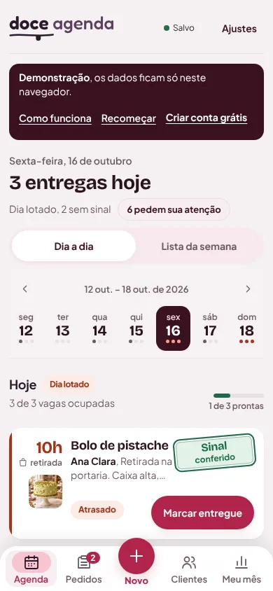
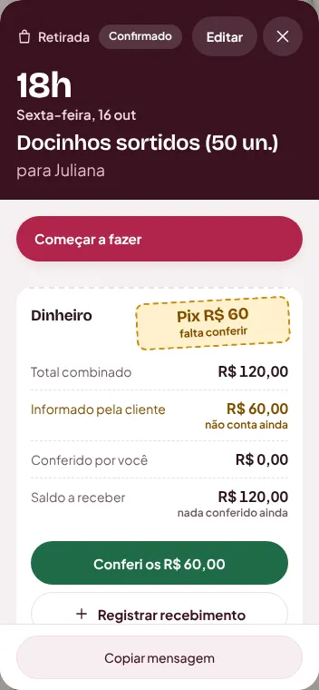
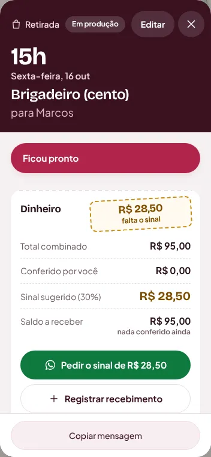
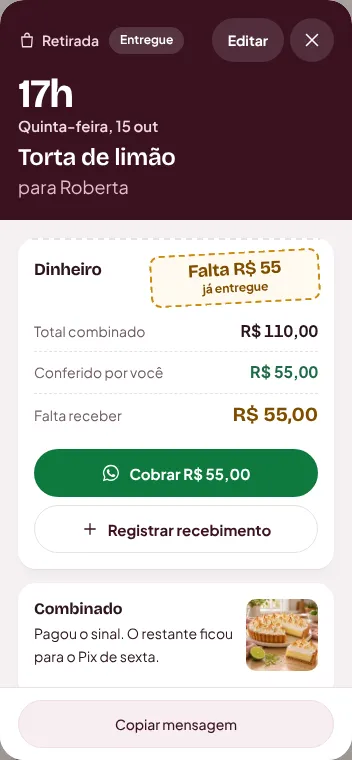
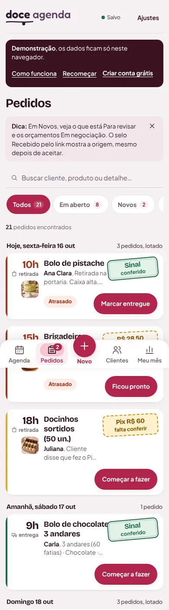
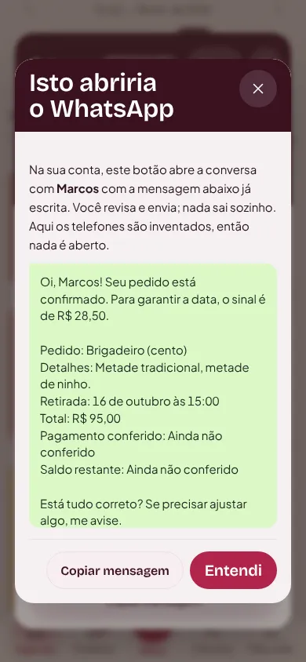
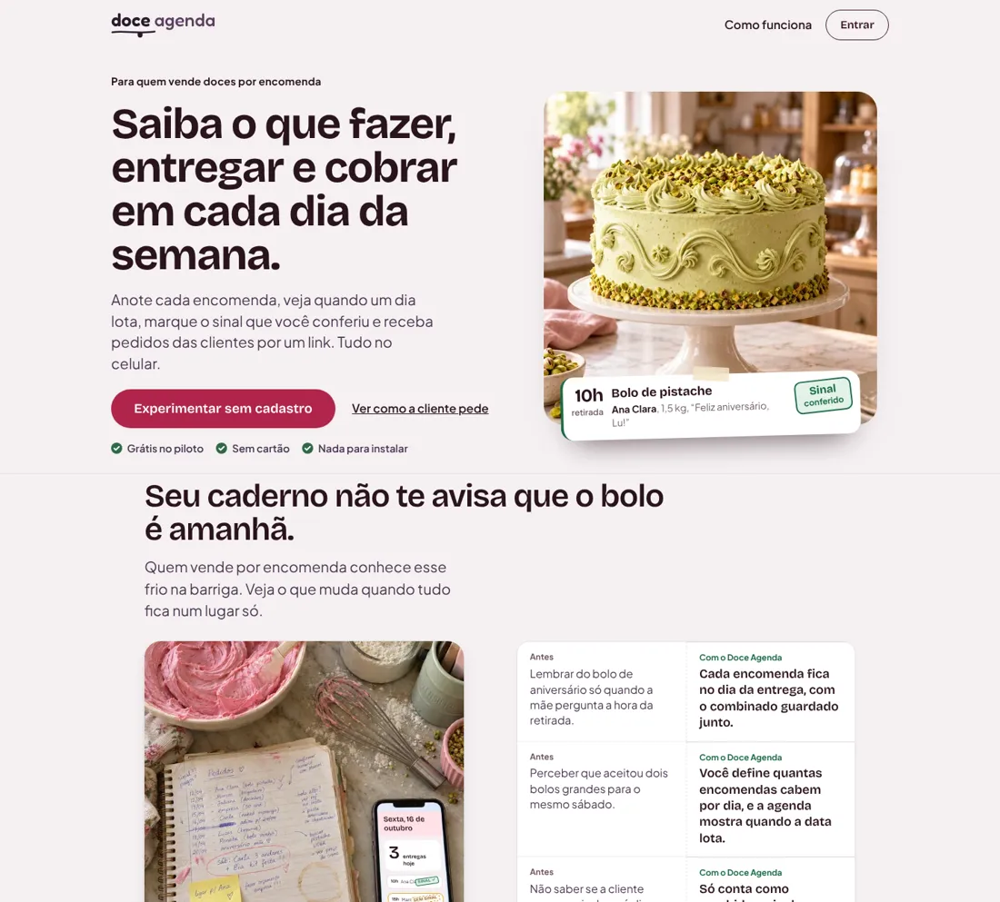

# Rodada 2: o que foi implementado

16/10/2026 · 11 commits sobre `11e6844`, de `de0b1ac` a `1ad6335`, incluindo o ajuste de toque `adddbb4` · **enviado ao GitHub e publicado em 16/10**, Cloudflare `dc5e3b77-a839-4c3e-9046-af083be9c290` (100% do tráfego), árvore `1ad6335`.

Relatório e protótipo que originaram esta etapa: `RELATORIO.md` e `prototipo/index.html`, nesta pasta.

## O que mudou, etapa por etapa

| Etapa | Commit | O que a confeiteira percebe |
|---|---|---|
| 0. Defeitos | `de0b1ac` | Pedidos volta a mostrar o dia de cada pedido e começa pelo que está em aberto. A linha do Pix informado não quebra mais letra por letra. A foto do combinado não espreme o bloco do sinal. "2 sem sinal" no lugar de "2 faltam o sinal". |
| 1. Carimbo com valor | `616f9fe` | O carimbo diz quanto: "R$ 28,50 falta o sinal", "Pix R$ 60 falta conferir", "Falta R$ 55 já entregue". Entregue com saldo nunca fica verde. Falta cobrar e Próximos dias usam o mesmo carimbo. |
| 2. Ficha | `78fbe53` | Hora grande no topo, "Editar" no cabeçalho. O dinheiro virou um canhoto: total, informado (não conta ainda), conferido, sinal sugerido e saldo, com a ação logo abaixo ("Conferi os R$ 60,00", "Pedir o sinal de R$ 28,50"). Telefone tocável. |
| 3. Agenda | `f4f5a37` | O título responde: "3 entregas hoje". A semana fica no topo e gruda ao rolar. O primeiro pedido aparece sem rolar. "Pedem sua atenção" junta pedido do link, Pix a conferir, saldos, sinais e próximas ações. O resumo financeiro saiu da Agenda (fica no Meu mês). |
| 4. Pedidos | `d518d97` | Lista agrupada por dia ("Hoje, sexta-feira 16 out"), novo filtro "Em aberto". A ficha da cliente usa as mesmas linhas, com dia, valor e carimbo. |
| 5. Tokens | `a666037` | Invisível para ela: raios e letras por tokens, fontes declaradas uma vez. Mapa do que ainda depende do visual antigo em `docs/GLACE_DEPENDENCIAS.md`. |
| 6a. Demonstração | `9a95024` | O botão verde do WhatsApp aparece na demonstração e mostra a mensagem que seria escrita, sem abrir nada. A tela não pula mais ao abrir. |
| 6b. Landing | `8eab492` | Topo com foto real e um pedido do app preso na bancada. Vitrine do exemplo com fotos. Mocks com o visual atual. Lotado em tijolo, como no app. Sem cartões flutuando. |
| Ajuste | `c05f979` | O WhatsApp não sugere "Pedir o sinal" quando a cliente já informou o Pix. Verde do WhatsApp mais escuro, com contraste AA. |
| Ajuste | `adddbb4` | Botões novos com 44 px de altura (atalho "pedem sua atenção", setas da semana, telefone da ficha). |

## Antes e depois (390 px, demonstração)

| | Antes | Depois |
|---|---|---|
| Agenda, primeira tela | `prototipo/img/antes-agenda-390.webp` | `img/depois-agenda-390.webp` |
| Ficha com Pix informado | `img/defeito-pix-letra-por-linha.webp` | `img/depois-ficha-pix-390.webp` |
| Pedidos | `img/pedidos-1440-sem-data.webp` | `img/depois-pedidos-390.webp` |
| Entregue com saldo | `img/defeito-entregue-com-saldo-verde.webp` | `img/depois-ficha-saldo-390.webp` |
| Landing, topo | `img/landing-1440-topo.webp` | `img/depois-landing-1440-topo.webp` |









## Critérios de validação

Medido no build local do mesmo código, em Chromium, com os dados da demonstração.

| Critério (do relatório) | Resultado |
|---|---|
| Cada cartão de Pedidos mostra o dia; "Todos" começa por hoje | **Passou.** Grupos por dia, o primeiro é "Hoje, sexta-feira 16 out" (teste em 320, 390 e 1440 px). |
| Linha do Pix sem quebrar letra por letra; bloco do sinal com a largura certa | **Passou** (teste mede a largura do texto e a foto contida no bloco). |
| Nenhum pedido com saldo depois da entrega aparece em verde | **Passou** (Roberta: "Falta R$ 55 já entregue"). |
| Na ficha com Pix informado, conferir aparece sem rolar a 390×844 | **Passou**, acima do rodapé fixo, e é o único botão de conferir. |
| Primeiro pedido da Agenda sem rolar a 390×844 | **Passou**: começa a 611 px, com o guia da demonstração aberto ou fechado. |
| Agenda da demo abaixo de 2.200 px | **Quase:** 2.486 px com o guia fechado (era 3.415) e 3.050 com o guia aberto (era 3.992). |
| Trocar de dia não exige rolar | **Passou:** a semana fica no topo e gruda ao rolar. |
| `vnext.css` com até 3 raios e 6 tamanhos de letra | **Parcial:** raios só por 5 tokens (cartão, controle, selo, janela, pílula). A escala de letras virou token, mas as telas antigas ainda usam tamanhos soltos. |
| `style.css` abaixo de 30% de uso | **Não:** 57% (era medido como ~69% por aproximação). Mapa em `docs/GLACE_DEPENDENCIAS.md`. |
| Nenhuma fonte declarada em dobro | **Passou:** app e landing carregam 3 arquivos de fonte; Outfit saiu. |
| CLS da demo abaixo de 0,1 | **Passou:** 0,045 a 1440 px (era 0,79) e 0,019 a 390 px (era 0,125). |
| Landing abaixo de 5.500 px no celular | **Não:** 7.987 px (era 8.270). Ver "O que não foi feito". |
| Landing sem rótulos acima dos títulos, sem celular com tela inventada, cores iguais às do app | **Passou** nos títulos de seção; restam os rótulos numerados dos três passos (são uma sequência de verdade). |
| axe 0 e sem rolagem lateral nas 6 larguras | **Passou:** 126 telas e janelas auditadas, 0 violações; 0 rolagem lateral de 320 a 1440 px; 0 erros de JavaScript. |
| `npm run check` | **Passou:** 64 regras e 12 suítes de tela (a nova `test-rodada2.mjs` cobre as etapas 0 a 4 e 6a). |
| Teste com confeiteiras | **Não feito.** Continua sendo o teste que mais importa. |

Problemas conhecidos que continuam: com a roda do mouse sobre o fundo escurecido, a página atrás da janela rola (no computador; tentei travar a rolagem, mas a página voltava ao topo, então desfiz); a prévia da vitrine (`?preview=1`) pula no primeiro carregamento por causa do aviso de prévia inserido no topo; alguns links de texto antigos (cadastro, rodapé da vitrine) têm menos de 44 px de altura.

## O que não foi feito (e por quê)

- **Remover o `style.css` antigo.** A medição mostrou que 57% dele ainda é aplicado; tirar de uma vez quebraria telas. Ficou o mapa em `docs/GLACE_DEPENDENCIAS.md` para migrar grupo por grupo, com comparação de capturas.
- **Landing com menos de 5.500 px no celular.** Ficou em cerca de 8.000 px (era 8.270). Para encurtar de verdade seria preciso cortar conteúdo (os três passos e as demonstrações), o que é decisão de produto.
- **Título da landing.** Mantido ("Saiba o que fazer, entregar e cobrar em cada dia da semana."): é bom e já estava aprovado.
- **Fotos novas.** Nenhuma imagem foi gerada. A landing usa as fotos que já existiam na vitrine de exemplo.
- **Aparelho real, Safari, conta real.** Não testados.

## Imagens que valem pedir ao GPT (opcional)

Regra: nenhuma imagem pode mostrar uma tela de app inventada. Onde houver celular, a tela deve vir apagada ou fora de foco; a interface de verdade é desenhada por cima em HTML.

1. **Bancada com a comanda de papel** (alternativa ao topo da landing): "Foto realista, luz natural de manhã, bancada de mármore claro de uma confeitaria caseira brasileira, uma caixa de bolo branca fechada com fita, e presa na tampa uma comanda de papel kraft escrita à mão, sem texto legível. Paleta: rosa framboesa suave, verde pistache, creme. Sem pessoas, sem logotipos, sem celulares. Formato quadrado 1:1, 1600 px."
2. **Pedido pronto para retirada** (passo "Ficou pronto"): "Foto realista de uma sacola kraft com uma caixa de doces dentro, sobre a bancada, ao lado de uma etiqueta de papel em branco presa com fita adesiva. Luz suave, fundo desfocado de cozinha doméstica, tons creme e framboesa. Sem texto, sem marcas, sem celular. Formato 4:3, 1600 px."
3. **Caderno sem celular** (seção "Seu caderno não te avisa"): a foto atual tem um celular cuja tela é coberta por HTML; se quiser trocar, peça a mesma cena "com o celular virado para baixo ao lado do caderno".

Salvar em WebP (qualidade 80) em `public/landing/assets/` e avisar: o HTML aponta o arquivo e o texto alternativo.

## Publicação realizada

O `npm run check` foi repetido no computador do Lucas: 64 regras e 12 suítes passaram. Push dos 11 commits concluído. A publicação real em `https://lucast.app` passou nas cinco rotas e em 19 verificações de Agenda, Pedidos, dinheiro, ficha Pix, WhatsApp da demo e landing, em 360×800, 390×844 e 1280×900. Os arquivos JS/CSS atualizados correspondem ao build local; HTML atual confirmado, sem interceptação dos arquivos nos testes. Capturas e resultado em `data/publicacao-r2/` (ignorado pelo Git). Nenhuma alteração de código, Supabase, DNS ou conta real nesta publicação.

Limitação observada: em 360×800 o botão de conferir fica parcialmente sob o rodapé ao abrir a ficha e exige uma pequena rolagem interna; após rolar fica totalmente visível e acessível. O critério aprovado de 390×844 passou sem rolagem. Não foi feita correção de interface nesta tarefa de publicação.

### Comandos de reprodução

O ambiente original da auditoria não tinha credenciais. A publicação foi feita depois, no computador do Lucas, na pasta do projeto:

```
npm run check
git push origin main
npx --yes --package wrangler@4.119.0 wrangler deploy --config wrangler.jsonc
node scripts/test-cloudflare-routing.mjs
```

Depois, abrir `https://lucast.app/demo/` no celular e conferir: Agenda com a semana no topo, ficha da Juliana com "Conferi os R$ 60,00", Pedidos por dia, e a landing com a foto do bolo de pistache.
