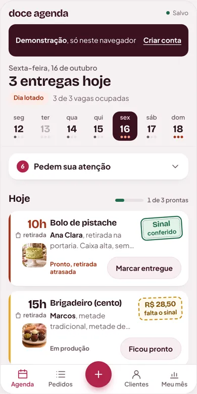

# Doce Agenda — auditoria de UI/UX, rodada 2 (pós-Comanda)

16/10/2026 · código auditado: `main` em `11e6844` (mesmo código do site no ar, `fe74b83`; o commit seguinte só mexe em documentação) · demonstração local montada com `npm run build`

> **Atualização (16/10, mais tarde):** Lucas pediu para executar todas as etapas. O que foi feito, testado e o que ficou pendente está em `IMPLEMENTACAO.md`, nesta pasta.

Este relatório, quando escrito, não alterou o app nem publicou nada. Capturas brutas e scripts ficam em `Documents/doce-agenda-auditoria/r2/`. As imagens citadas aqui estão em `img/`. O protótipo está em `prototipo/index.html` (abre direto no navegador).

> **Limitação de método.** O endereço `lucast.app` não abre a partir do ambiente da auditoria (a rede bloqueia o domínio). Por isso tudo foi medido no build local do mesmo código, servido como o site publicado, inclusive a rota `/p/<slug>`. Chamadas ao Supabase também ficaram bloqueadas: cadastro e entrada mostram a mensagem de "sem conexão", o que **não** é defeito do produto. Safari, iPhone e aparelho físico não foram testados.

---

## 0. Resumo para decidir

**Diagnóstico em uma frase:** a Comanda acertou as peças (cartão, carimbo, cores, acessibilidade); o que ainda impede a sensação de produto maduro agora é **o sistema**: telas que empilham blocos, o dinheiro falando três línguas e um visual antigo que continua pintando dois terços do app por baixo.

### O que mudou desde a rodada 1

| Dimensão | Rodada 1 | Agora | Por quê, em uma linha |
|---|---|---|---|
| Regras e confiança | 4,5 | 4,5 | Continua raro: só o conferido conta, pedido do link não ocupa vaga. |
| Arquitetura de informação | 3 | 3 | Cabeçalhos ficaram curtos, mas a Agenda cresceu para 9 blocos e ~4.000 px no celular. |
| Design visual | 2,5 | **3,5** | Carimbo, hora grande e fotos deram identidade. A vitrine está no nível de produto pago. |
| Consistência / design system | 2 | **2,5** | Uma família de cores e duas fontes. Mas o CSS antigo ainda pinta ~2/3 das telas e há 13 raios e ~20 tamanhos de letra diferentes. |
| Ergonomia mobile | 3,5 | **4** | Botões de 48 px, "Novo" no centro, nenhuma rolagem lateral de 320 a 1440 px. |
| Acabamento técnico | 2,5 | **3** | axe com zero violações em todas as telas. Mas surgiram defeitos novos (datas sumidas, linha do Pix quebrada, tela que pula). |

### As cinco coisas que eu faria primeiro

1. **Corrigir quatro defeitos** que um usuário percebe em segundos (Fase 0, cerca de meio dia): datas sumidas na lista de Pedidos, linha do Pix uma letra por linha, foto que espreme o bloco do sinal, e "Todos" começando pelos pedidos de 2025.
2. **Um carimbo só, em todo lugar, e com valor.** Entregue com saldo nunca pode ficar verde. "Falta cobrar", ficha, Clientes e landing usam a mesma peça.
3. **Agenda com uma pergunta só: "o que faço hoje?"** A semana sobe para o topo, tudo que pede decisão ou cobrança vira uma linha recolhível, e o resumo financeiro sai da Agenda (o Meu mês é o dono do dinheiro).
4. **Ficha na ordem do trabalho:** hora grande, próximo passo, dinheiro com a ação logo abaixo, combinado, contato.
5. **Landing que mostra o produto de verdade:** fotos da vitrine e o carimbo no lugar de seis celulares desenhados e cartões flutuando.



### Onde eu discordo das suas impressões (desta vez)

- **"Componentes genéricos / pouca personalidade":** isso já não é o problema principal. O cartão Comanda e o carimbo têm personalidade. A sensação de "genérico" agora vem de **composição**: muitos blocos brancos empilhados com o mesmo peso. A solução é **tirar**, não acrescentar.
- **"Ícones que poderiam comunicar melhor":** discordo. O conjunto atual (traço 1,7, cada ícone ligado a um conceito) está bom e contido. Não proponho nenhum ícone novo, só usar os que existem nos lugares novos (Pix e carteira na linha de atenção).
- **"WhatsApp com botão verde, ícone oficial e mensagem contextualizada":** **já está feito**, e bem feito ("Pedir o sinal de R$ 54", "Avisar que está pronto"). O problema é que **a demonstração esconde o botão**, e a demonstração é o que a landing vende. Quem testa nunca vê a sua melhor função. Proposta na seção 3.14.
- **"Microinterações":** o app já tem o momento certo (o carimbo batendo quando você confere). Não recomendo mais animação. Recomendo que esse momento apareça na hora certa: hoje ele quase nunca é visto porque o botão "Marcar conferido" fica no fim da ficha.
- **"Inconsistências de espaçamento e tipografia":** concordo, e agora tenho números (seção 4). Mas a causa não é descuido de tela por tela: é o CSS antigo vivo por baixo.

---

## 1. Ferramentas usadas

| Recurso | Situação | Uso |
|---|---|---|
| Skill `frontend-design` | Disponível no ambiente | Direção estética do protótipo e checagem dos "tiques de modelo" (rótulo acima do título, "→" em botão, " · " entre informações, cartões flutuando) |
| Skill `web-design-guidelines` (vercel-labs) | **Já instalada** em `.claude/skills/` na rodada 1 | Regras baixadas na hora e aplicadas por busca no código (seção 5.4) |
| Playwright 1.62.1 | Já existia no projeto | Capturas e auditoria automática em 320, 360, 390, 768, 1024 e 1440 px |
| `@axe-core/playwright` / axe-core 4.10 | Já instalado em `doce-agenda-auditoria/` | Acessibilidade automática em todas as telas e janelas |
| Testes do próprio projeto | `npm test` (64 regras) e `npm run test:ui` (11 suítes) | **Todos passaram** antes da auditoria: nada estava quebrado do ponto de vista dos testes, o que diz algo sobre o que os testes não cobrem (datas da lista, linha do Pix) |
| Subagentes | **Não usei** | O `AGENTS.md` só permite o `triagem-haiku`, e o trabalho cabia no agente principal |

Nada foi instalado no repositório. A cópia de trabalho usada para o build ficou fora dele.

---

## 2. Os sete fatores que mais derrubam a qualidade percebida agora

Ordenados pelo efeito na sensação de "produto maduro". Cada item diz o tipo: **[Defeito]** confirmado, **[Usabilidade]**, **[Design]** (avaliação subjetiva minha) ou **[Hipótese]** (precisa de teste com gente real).

### F1. Defeitos visíveis em telas centrais [Defeito] · P0

| # | O que acontece | Onde | Causa no código |
|---|---|---|---|
| D1 | **Os cartões da lista de Pedidos não mostram a data**, só a hora. Em 21 pedidos, ninguém sabe se "15h" é hoje ou de 2025. | Pedidos, todas as larguras (`img/pedidos-1440-sem-data.webp`) | `app.js:389`: `.replace(/./g, "")` apaga **todos** os caracteres do rótulo do dia. Era para ser `/\./g` (só os pontos). |
| D2 | **A descrição do Pix informado quebra uma letra por linha** e o botão "Marcar conferido" fica espremido. | Ficha, 320/360/390 px (`img/defeito-pix-letra-por-linha.webp`) | `.payment-item` vem do CSS antigo (`style.css:158`, flex sem `min-width: 0` no texto). O vnext só troca a borda. |
| D3 | **A foto do combinado "vaza" e espreme o bloco do sinal** (o sinal fica 100 px mais estreito que o resto). | Ficha, 768 px ou mais (`img/defeito-foto-espreme-sinal-1440.webp`) | `vnext.css:488`: a foto usa `float: right`, mas `.detail-summary` não contém o float (falta `display: flow-root`). |
| D4 | **"Todos" começa pelos pedidos mais antigos** (o primeiro é de novembro de 2025). Os de hoje aparecem depois de 12 pedidos antigos (11 entregues e 1 cancelado). Somado ao D1, a lista vira um amontoado sem tempo. | Pedidos → Todos | `sortOrders` (`app.js:110`) ordena do mais antigo para o mais novo para todas as abas. |
| D5 | **A demonstração "pula" ao abrir no computador**: CLS de 0,79 a 1440 px (o limite bom é 0,1) e 0,125 no celular. | Demo, primeira carga | O conteúdo e o rodapé descem quando o JavaScript monta a tela (`topbar-actions`, `main`, `app-footer`). Já estava anotado no `context.md` como pendência. |
| D6 | Título da solicitação quebra com o ponto no começo da linha: "Solicitação DA-DEMO15 / · Aguardando revisão". | Ficha de solicitação, 390 px (`img/ficha-solicitacao-390.webp`) | Rótulo e situação na mesma string unida por " · ". |
| D7 | Texto com erro de concordância no cabeçalho da Agenda: "2 faltam o sinal". | Agenda | Frase montada; o certo seria "falta o sinal em 2" ou "2 sem sinal". |

### F2. O dinheiro ainda fala três línguas [Usabilidade] · P1

A regra da marca diz "um carimbo só". Na prática:

- **Cartões** usam o carimbo (bom).
- **"Falta cobrar"** na Agenda usa **pílulas** amarelas ("Falta o sinal", "Entregue, falta receber R$ 55,00"), outra forma para a mesma informação (`img/agenda-falta-cobrar-pilulas-390.webp`).
- **A ficha** usa um bloco amarelo com **"R$ 0,00" gigante** quando falta o sinal: a maior coisa da ficha é um zero (`img/ficha-falta-sinal-390.webp`). E quando já foi tudo pago, o bloco continua se chamando "Sinal" e mostra o total.
- **Clientes** usa cartões com fundo verde/creme do visual antigo e "Saldo R$ 90,00" em texto (`img/cliente-ficha-cartoes-antigos-390.webp`).
- **A landing** usa pílula "Sinal conferido" em vez do carimbo.

**O caso mais sério:** um pedido **entregue com R$ 55 em aberto** (Roberta) aparece na lista com o carimbo **verde "Sinal conferido"** (`img/defeito-entregue-com-saldo-verde.webp`). O texto é verdadeiro, mas a cor diz "tudo certo" justamente no pedido que precisa de cobrança. A causa está em `moneyStamp` (`app.js:373`): depois que há qualquer pagamento conferido, o carimbo só distingue "Sinal" de "Total".

**Também confunde:** no computador, a Agenda tem um painel "Resumo financeiro" com "Saldo a receber R$ 605,00" (soma só os pedidos que já têm algum pagamento conferido; os 3 sem nenhum ficam de fora, avisados numa nota pequena), enquanto Meu mês mostra "A receber R$ 730,00" (pedidos do mês). Os dois estão corretos dentro da sua regra, mas **dois nomes quase iguais para números diferentes** é exatamente o que gera desconfiança em quem tem ansiedade com dinheiro (`img/agenda-1440-resumo-financeiro.webp`).

Isto é usabilidade, não erro de cálculo: nenhuma tela soma informado como recebido.

### F3. A Agenda virou uma pilha [Usabilidade] · P1

A 390 px a Agenda da demonstração tem **nove blocos** e cerca de **4.000 px** de altura (`img/agenda-inteira-390.webp`): faixa da demo, "Experimente em 1 minuto", "Pedido novo pelo link", mês + chave Dia a dia/Lista, cartão do dia, encomendas de hoje, "Ver outro dia da semana", "Falta cobrar", "Próxima ação", "Próximos dias" e o aviso de cópia de segurança.

Consequências:
- **A primeira tela continua sem nenhum pedido** (na demo, por causa do "Experimente"; numa conta real, o cartão do dia e o "Pedido novo pelo link" ainda empurram a lista para baixo).
- **A semana fica depois da lista de hoje.** Para ver outro dia, rola-se até o meio da tela, toca-se no dia, e a tela sobe de volta. A navegação está embaixo do conteúdo que ela controla.
- **Três blocos fazem o mesmo trabalho** ("Pedido novo pelo link", "Falta cobrar", "Próxima ação"): avisar que algo pede uma ação. Cada um com um formato.
- "Próximos dias" é um cartão dentro de um cartão, com carimbos abreviados ("Sinal", "Falta") que perdem o sentido sem o complemento.

### F4. O visual antigo continua vivo por baixo [Defeito de arquitetura] · P1

O `context.md` trata o CSS Glacê como "morto, falta remover". A medição diz outra coisa: com a cobertura de CSS do Chromium, navegando por todas as abas e janelas da demo, **cerca de 69% do `style.css` (100 KB) é aplicado** a algum elemento. O `vnext.css` (54 KB) é carregado depois e corrige por cima.

Isso explica por que surgem defeitos "do nada": a linha de pagamento (D2), os cartões de pedido na ficha da cliente, o formulário de recusa e várias janelas ainda têm o desenho do Glacê com uma demão de vnext. **Remover o Glacê não é faxina, é migração** de cada componente que ainda depende dele.

### F5. A ficha está de cabeça para baixo [Usabilidade] · P1

Na ficha da Juliana (Pix informado), a ordem é: próximo passo → telefone → combinado → bloco "Sinal R$ 60,00" → aviso → "Valor total R$ 120" → "Saldo a receber R$ 120" → **Pagamentos, com o botão "Marcar conferido"**. O valor de R$ 120 aparece três vezes antes da única ação que mexe no dinheiro.

Além disso:
- **Dois botões cheios** disputam a atenção: o próximo passo ("Ficou pronto") e "Editar", no rodapé fixo.
- A hora, que é o eixo da Agenda, vira texto de 13 px no topo da ficha ("sex, 16 out · 15h").
- O telefone é texto simples, sem ação.
- A frase "O sinal só conta quando você confirma que recebeu" aparece em todas as fichas, até nas já pagas.

### F6. Landing: bom texto, estrutura de modelo pronto [Design] · P2

O texto da landing é o melhor que já teve ("Seu caderno não te avisa que o bolo é amanhã." é ótimo). O que a deixa com cara de modelo:

- **7 rótulos coloridos acima dos títulos** ("Link de encomenda", "Como funciona", "Anote o pedido"…), o tique que a própria marca proibiu dentro do app.
- **6 celulares desenhados** e **cartões flutuando em volta do aparelho** ("Dia lotado", "Sinal conferido R$ 90,00", "Nova solicitação"), com movimento infinito.
- **Ilustrações desatualizadas em relação ao app:**
  - na demonstração da semana, **amarelo = lotado**; no app, lotado é **tijolo** (`img/landing-semana-amarelo-seta-390.webp`);
  - os botões das demonstrações ainda têm "→" ("Ficou pronto →", "Começar a fazer →"), que a Comanda removeu do app;
  - "Como chega para você" mostra a tela com o desenho antigo (botão preto, cartão rosa) (`img/landing-mock-desatualizado-390.webp`);
  - "Como a cliente vê" mostra bolos **desenhados**, enquanto a vitrine real já tem 22 fotografias;
  - o celular sobre o caderno (foto da cozinha) mostra uma interface que nunca existiu ("3 para entregar" em verde).
- **Quatro cartões "Antes / Com o Doce Agenda" iguais** em sequência e o padrão "texto de um lado, imagem do outro, alternando" no computador.
- Comprimento: **8.270 px no celular**.
- Letras de 11 px nos cartões flutuantes (abaixo do mínimo de 12 px da marca).

O que está bom e deve ficar: título do herói, a seção do link (1-2-3 é uma sequência de verdade), "Nenhum pagamento é pedido pelo link", FAQ, o bloco final escuro. Desempenho ótimo (LCP abaixo de 0,8 s, CLS ≈ 0,005 no computador).

### F7. A demonstração esconde o que vende [Usabilidade] · P2

- O botão verde do WhatsApp é **desligado na demo** (telefones inventados). Sem ele, a ficha mostra "Copiar mensagem" e "Editar", e a pessoa que veio da landing não vê a função mais desejável.
- "Experimente em 1 minuto" ocupa a primeira tela inteira no celular e é a primeira coisa que alguém vê ao chegar pela landing.
- No tablet (768 px) aparecem **dois botões "Nova encomenda"** na mesma tela (cabeçalho e título) (`img/tablet-768-dois-botoes-novo.webp`).

---

## 3. Auditoria por tela

Prioridade: **P0** corrigir já · **P1** próxima etapa · **P2** depois · **P3** quando der.

### 3.1 Agenda
- **Bom:** cartão Comanda com hora grande, foto do produto, filete lateral com a cor do dinheiro; "1 de 3 prontas" com barra; "Dia lotado" em tijolo; foco de teclado visível (anel verde de 3 px).
- **Problemas:** F3 inteiro; D7; carimbo "Pix falta conferir" em três linhas apertadas a 1440 px; "Por horário" parece link mas é só texto; a 320 px o rótulo "Meu mês" da barra quebra em duas linhas e o último conteúdo fica 4 px atrás da barra.
- **Recomendação (P1):** semana fixa no topo (navegação acima do conteúdo); uma linha "Pedem sua atenção (6)" recolhível que junta pedido do link, Pix a conferir, sinais e saldos; "Hoje" com o progresso no título da seção; "Próximos dias" em linhas baixas, sem cartão dentro de cartão; resumo financeiro do computador sai (vai para Meu mês). Ver `img/proposta-agenda.webp` e `img/proposta-agenda-atencao.webp`.

### 3.2 Seleção de dias e semanas
- **Bom:** o dia mostra "3/3" e "Lotado"; setas de semana.
- **Problemas [Usabilidade]:** fica abaixo da lista; a 320 px cada dia tem 38,6 px de largura (abaixo de 44); o dia escolhido usa framboesa, que pela marca é cor de ação, não de estado.
- **Recomendação:** faixa de 7 dias no topo, com pontinhos de ocupação (tijolo quando lota) e o dia escolhido em vinho.

### 3.3 Cartões das encomendas
- **Bom:** um verbo por cartão; o título abre a ficha e o cartão inteiro é a área de toque (os 22 px de altura do título medidos pelo teste são falso alarme, porque um `::after` estica a área).
- **Problemas [Design]:** três botões cheios framboesa seguidos competem com o "Novo" e entre si; quando falta dinheiro, o carimbo não diz quanto; "retirada" aparece duas vezes (embaixo da hora e no detalhe).
- **Recomendação (P1):** ação do cartão em tom suave (fundo rosa, texto vinho, 44–48 px); o único botão cheio da tela é o "Novo". Carimbo com valor: "R$ 28,50 / falta o sinal", "Pix R$ 60 / falta conferir", "Falta R$ 55 / já entregue".

### 3.4 Lista e filtros de pedidos
- **Problemas:** D1 e D4 [Defeito]; "Dica" + "Pedido novo pelo link" + busca + filtros antes do primeiro pedido (a lista começa abaixo da primeira tela); filtros escondidos à direita sem indicação de rolagem; no computador o cartão se estica por 1.100 px com um vazio no meio.
- **Recomendação:** P0 corrigir D1/D4. P1 agrupar por dia ("Hoje, sexta 16", "Amanhã, sábado 17") com cabeçalhos que grudam no topo e linhas baixas (hora, produto, cliente, valor, carimbo pequeno); primeiro filtro "Em aberto" (inclui entregue com saldo). Ver `img/proposta-pedidos.webp`.

### 3.5 Novo pedido
- **Bom:** 5 campos visíveis, "Hoje/Amanhã", detalhes recolhidos em "Mais detalhes", teclado numérico no valor, `autocomplete="tel"` no contato.
- **Problemas:** a validação usa o balão nativo do navegador (aparece no idioma do navegador e no estilo do sistema), destoando dos erros em tom de conversa do resto do app [Usabilidade, P2]; "Hoje" e "Amanhã" têm 43 px; "Use só o necessário para identificar a encomenda" sob o nome parece aviso jurídico [Design, P3].
- **Não testado:** teclado aberto em aparelho real.

### 3.6 Ficha detalhada
- **Problemas:** D2, D3, D6 e F5.
- **Recomendação (P1):** cabeçalho vinho com **hora grande** (40 px) e data ao lado; "Editar" vira botão de texto no cabeçalho; barra de etapas discreta; próximo passo cheio; **canhoto do dinheiro** logo abaixo (seção 7); combinado com foto contida; contato com o telefone tocável; histórico recolhido. Ver `img/proposta-ficha.webp`, `img/proposta-ficha-falta-sinal.webp`, `img/proposta-ficha-saldo.webp`.

### 3.7 Controle de produção (Lista da semana)
- **Bom:** "10 pedidos · 4 prontos", marcar pronto com um toque, "Copiar lista".
- **Problemas [Design, P3]:** mesmo padrão de "cartão branco com título" de todo o resto; sem relação visual com a Agenda (outra forma de linha de pedido).
- **Recomendação:** usar as mesmas linhas baixas de Pedidos, com a caixa de marcar à esquerda.

### 3.8 Pagamentos e sinais
- **Bom:** a regra informado × conferido é respeitada em todas as telas; o verde "Marcar conferido" é a única ação que muda dinheiro; o carimbo "PAGO 26 OUT" na ficha.
- **Problemas:** F2, D2; "Registrar" é botão de contorno pequeno no canto de um cartão que fica no fim da ficha.
- **Recomendação:** o canhoto com uma linha por fato (Total combinado / Informado pela cliente, "não conta ainda" / Conferido por você / Falta) e a ação logo abaixo. Ver seção 7.

### 3.9 Meu mês
- **Bom:** "Recebido" em verde e em destaque, "só o que você conferiu"; valores sem quebra (a rodada 1 corrigiu "R$ 1.800,"/"00").
- **Problemas [Design, P2]:** a regra "recebido = conferido" é explicada **três vezes** na mesma tela (Dica, bloco escuro "Recebido não é lucro." com rótulo de marketing "Mais clareza, menos papel", e o rodapé); o quarto cartão ("Pedidos") fica sozinho numa grade de dois; contagens em framboesa ("3 pedidos") usam a cor da ação para dado.
- **Recomendação:** manter uma explicação só (a do rodapé, com "Como calculamos"); Pedidos como linha de texto sob os três valores; números em tinta, não em framboesa.

### 3.10 Clientes
- **Bom:** "Datas que se repetem" é uma ideia excelente e rara; "Faz tempo que não pedem".
- **Problemas:** os pedidos dentro da ficha da cliente usam o **cartão antigo** (fundo verde inteiro, creme, "Pronto"/"Entregue" em pílula) [Design, P2]; "Total R$ 400,00" encosta na borda do quadradinho a 390 px [Defeito leve, P2]; datas sem ano ("qua., 05 nov.") num pedido de 2025 [Usabilidade, P2].
- **Recomendação:** usar as linhas de Pedidos; mostrar o ano quando não for o ano atual.

### 3.11 Ajustes
- **Bom:** quatro grupos recolhidos com resumo ("Todos os dias · até 3 por dia"); prévia da vitrine dentro do app.
- **Problemas:** "Dias em que você **não** aceita pedidos" pede uma escolha negativa, e nenhum selecionado parece igual a todos desligados [Usabilidade, hipótese, P3]; o item escolhido usa vinho aqui e framboesa nos filtros de Pedidos [Design, P3].
- **Recomendação:** "Dias em que você atende", com os dias de atendimento marcados.

### 3.12 Cadastro e entrada
- **Bom:** mensagem de erro clara e em tom de conversa ("Não conseguimos falar com o servidor. Confira a internet ou desative o bloqueador de anúncios"), "Mostrar" senha, links de privacidade.
- **Limite:** o servidor estava inacessível no ambiente; fluxo completo não testado.
- **Problemas menores:** "Esqueci minha senha" e "política de privacidade" com 18–19 px de altura de toque [P3].

### 3.13 Vitrine pública e jornada da cliente
- **Bom:** é a tela mais madura do produto. Capa, logo, fotos grandes, "Próxima data livre", "Mais pedidos", categorias, ficha do produto com foto inteira e "Quero este", passo a passo em 3 etapas, "Incluir mais alguma coisa?". axe sem violações, sem rolagem lateral, nada de serviço externo.
- **Problemas:** "MAIS PEDIDO" em **maiúsculas de 11 px** (abaixo do mínimo e o tique proibido) [P2]; categorias com 42 px [P3]; título "Mais pedidos" + etiqueta "MAIS PEDIDO" em cada foto repete a informação [P3]; passo "1 de 3" mostrado duas vezes (barra e círculo numerado) [P3]; sem foto, a ficha do produto mostra uma **letra gigante** ("B"), contrariando a regra "sem letra no lugar de foto" [Design, P3] (o cartão da lista já foi corrigido, a ficha não).
- **Observação de produto:** a vitrine agora parece mais cara do que o app que a confeiteira usa. Isso é bom para vender, mas reforça que a próxima etapa do app é composição, não enfeite.

### 3.14 Demonstração sem cadastro
- **Problemas:** F7 e D5; faixa da demo com links de 36 px de altura [P2].
- **Recomendação (P2):** na demo, **mostrar** o botão verde e, ao tocar, abrir uma janela "Isto abriria o WhatsApp da Juliana com esta mensagem:" com o texto pronto e "Entendi". Ensina a função sem enviar nada. "Experimente em 1 minuto" vira a própria faixa da demo ("0 de 4 · Continuar"), recolhida.

### 3.15 Landing page
Ver F6. Recomendação (P2), mostrada em `img/proposta-landing-1440.webp` e `img/proposta-landing-390.webp`:
1. **Herói:** título e texto à esquerda; à direita uma **foto real** da vitrine (bolo de pistache) com **um cartão Comanda de verdade preso por uma fita**, carimbo verde. Sem celular desenhado e sem cartões flutuando.
2. **"Uma encomenda, do recado à entrega":** o bolo da Camila em quatro momentos (vitrine com foto → aceitar com a ocupação da data → carimbo do sinal → botão verde "Avisar que está pronto"). Substitui as três seções "1 / 2 / 3" e os quatro cartões "Antes / Com o Doce Agenda".
3. **"Recebido é só o que você conferiu."** com o canhoto do dinheiro.
4. Manter: seção do link, FAQ, bloco final.
5. Tirar os rótulos acima dos títulos, os "→" e o movimento infinito. Um único momento de movimento: o carimbo batendo quando a seção do dinheiro entra na tela.
6. Trocar os desenhos de bolo pelas fotos que já existem em `encomenda/exemplos/`.
7. Meta: menos de 5.500 px no celular.

### 3.16 Janelas, estados vazios e mensagens
- **Bom:** Esc e o botão Fechar fecham as janelas e devolvem o foco ao elemento que abriu; toast "Ana Clara: Entregue. Desfazer" com desfazer; estado vazio "Nada por aqui com esse filtro"; erro de armazenamento bloqueado explicado.
- **Problemas:** com a roda do mouse sobre o fundo escurecido, **a página atrás da janela rola** (de 0 para 400 px no teste) e, ao fechar, a pessoa está em outro ponto da lista [Defeito em computador, P2; no toque precisa de aparelho real]; com armazenamento bloqueado, o título "Armazenamento indisponível" aparece duas vezes a 390 px [P3].

---

## 4. Inventário do design system

| Item | Medição | Leitura |
|---|---|---|
| Folhas no app | `tokens.css` 4 KB, `doce-wa.css` 3 KB, **`style.css` 100 KB**, `vnext.css` 54 KB | Duas camadas. ~69% do `style.css` é aplicado em algum ponto da demo. |
| `!important` | 27 em `style.css`, 0 em `vnext.css` | O antigo força; o novo vence por ordem e especificidade (`.vnext .detail-dialog …`). |
| Cores literais | 58 hexadecimais diferentes no `vnext.css` (147 usos) para 33 variáveis | Metade das cores do sistema novo não passa pelos tokens. |
| Raios | 13 valores no `vnext.css` (999, 30, 24, 22, 20, 18, 16, 14, 13, 12, 10, 50%, 0) | A marca define 3 (18, 14 e pílula). |
| Tamanhos de letra | ~20 valores (12, 13, 14, 15, 16, 17, 18, 19, 20, 21, 22, 24, 26, 28 e quatro `clamp`) | Proposta: 12 · 14 · 16 · 20 · 28 · 40. |
| Fontes | Bricolage declarada 3 vezes (`tokens.css`, `vnext.css`, `landing.css`); **Outfit** ainda declarada em `vnext.css` e `landing.css` | O navegador registra a mesma família duas vezes no app. Outfit não aparece em nenhum texto medido. |
| Botões | `.button` (34 usos), `.vn-btn` (6), `wa-button` (8 no HTML), `.text-link` (25), `.icon-button`, `.vn-zap`, `.row-advance` | Três sistemas de botão para o mesmo trabalho. |
| Selecionado | Vinho (Ajustes), framboesa (filtros de Pedidos e dia da semana) | Dois estados de "escolhido". |
| Web Awesome | 6 componentes no app (button, input, textarea, select, option, checkbox), FAQ da landing (`wa-details`) | Bem usada nos formulários. O pacote `app-wa.js` tem 244 KB sem compressão: vale conferir quanto chega comprimido antes de decidir algo. **Não recomendo trocar.** |
| Motion | Só na landing (`landing/main.js`); o app usa CSS para o carimbo | Uso correto. Não levar Motion para o app: o CSS basta. |
| Ícones | 22 ícones de traço + WhatsApp preenchido (`ui/icons.js`) | Coeso. Não precisa de mais. |

**Conclusão técnica:** a stack (HTML, CSS, JS, Web Awesome, Motion) está bem escolhida e **não há motivo para migrar**. O problema é de organização: um único arquivo de tokens com a escala de letras e raios, um único botão, e migrar componente por componente para fora do `style.css`.

---

## 5. Resultados do Playwright

### 5.1 Cobertura
6 larguras (320×640, 360×780, 390×844, 768×1024, 1024×768, 1440×900), cerca de 75 capturas por largura: landing, cadastro, entrada, privacidade, prévia da vitrine, link inexistente, Agenda (seções, Dia a dia e Lista da semana), Pedidos (7 filtros, busca vazia e com resultado), Clientes e ficha da cliente, Meu mês, Ajustes (cinco grupos), restaurar, novo pedido (vazio, validação, mais detalhes), quatro fichas (solicitação, sem sinal, Pix informado, entregue), recebimento, recusa, toasts, aceite, foco por teclado, armazenamento bloqueado. Mais a vitrine da Lu com fotos, ficha do produto e passo 1 em 320/390/1440 px, e a landing com e sem movimento.

### 5.2 Verificações automáticas
| Verificação | Resultado |
|---|---|
| Rolagem lateral | **0** em todas as telas e larguras |
| axe (WCAG 2 A/AA) | **0 violações** em todas as telas e janelas auditadas (eram 170 problemas de contraste na rodada 1) |
| Erros de JavaScript | **0** |
| Recursos de terceiros | Nenhum, exceto o Supabase (esperado e bloqueado no ambiente) |
| Elementos sobrepostos | Só "Mostrar" dentro do campo de senha (intencional) |
| Textos abaixo de 12 px | Landing (cartões flutuantes 11 px, celulares em miniatura), vitrine ("MAIS PEDIDO" 11 px) |
| Alvos de toque abaixo de 44 px | Faixa da demo (36 px), dias da semana a 320 px (38,6 px de largura), "Hoje/Amanhã" (43 px), categorias da vitrine (42 px), links de texto no cadastro |
| Foco por teclado | Visível em todos os 10 primeiros Tab (anel verde de 3 px, afastado 3 px) |
| Janelas | Esc fecha e devolve o foco; a página de trás rola com a roda do mouse |

### 5.3 Defeitos reproduzidos
D1 a D7 (seção 2, F1), cada um com captura em `img/` e, quando possível, a linha de código responsável.

### 5.4 Regras do Web Interface Guidelines (busca no código)
- `transition: all`: nenhum. Zoom bloqueado: não. `autofocus`: não. Imagens sem dimensão na landing: nenhuma.
- `outline: none` sem substituto: **não encontrado**. Os casos (`vnext.css:88, 519, 556`; `order.css:165, 219`) são títulos que recebem foco por programa ou têm substituto (`.vn-order:has(.vn-open:focus-visible)`).
- `touch-action: manipulation`: só 1 regra no app; ausente na vitrine. [P3]
- `env(safe-area-inset-*)`: só no `style.css` antigo (5 regras); o `vnext.css` não usa. Na migração do Glacê, levar junto, senão a barra de baixo encosta na barra do iPhone. [Hipótese, P2]
- `theme-color`: o app usa `#f5f1f2` (bate com o fundo); a landing usa `#fff8f8` (não bate com o fundo novo). [P3]

---

## 6. Acessibilidade e desempenho

| Medida | Resultado | Leitura |
|---|---|---|
| axe | 0 violações | Excelente. Manter como critério de aceite. |
| Contraste | Sem falhas automáticas | Os textos caramelo sobre baunilha passam. |
| Foco | Visível e consistente | Bom. |
| Movimento | `prefers-reduced-motion` respeitado no app e na landing | Bom. |
| CLS da demo | **0,79** a 1440 px, **0,125** a 390 px | Ruim. A tela pula ao abrir. |
| CLS da landing | 0,001–0,052 | Bom. |
| LCP | Landing 0,7 s; demo 0,3 s (servidor local, sem rede real) | Bom, mas medido sem rede: não vale como número de campo. |
| Peso da demo | ~860 KB sem compressão, 18 arquivos | `app.js` 144 KB e `app-wa.js` 244 KB. Medir comprimido no site publicado. |

**Limitações:** sem leitor de tela real (VoiceOver/TalkBack), sem Safari, sem rede lenta simulada, sem aparelho físico.

---

## 7. Direção proposta: "Comanda, segunda demão"

Não proponho direção nova. A Comanda está certa; falta aplicá-la ao **sistema** e não só às peças. Cores, letras, ícones e carimbo ficam iguais.

**Princípios (acrescentam aos cinco do `BRAND.md`):**

1. **Uma pergunta por tela.** Agenda = "o que faço hoje?". Pedidos = "onde está tal pedido?". Meu mês = "quanto entrou?". O que responde outra pergunta sai da tela ou vira uma linha.
2. **A navegação vem antes do que ela controla.** A semana fica no topo da Agenda; filtros e datas no topo de Pedidos.
3. **O carimbo diz quanto.** Toda vez que falta dinheiro, o carimbo mostra o valor. Verde só quando não falta nada que aquele momento exige. Entregue com saldo é sempre caramelo.
4. **O dinheiro é um canhoto.** Na ficha, uma linha por fato, com a ação logo abaixo. Nunca um número gigante de zero.
5. **Um botão cheio por tela.** Ação de cartão em tom suave; cheio só o próximo passo da ficha ou o "Novo".
6. **O que se pede para fazer aparece num lugar só** ("Pedem sua atenção"), com um verbo por linha.
7. **Mostrar, não ilustrar.** Na landing, fotos reais e telas reais. Nenhum celular desenhado com interface que não existe.

**O canhoto do dinheiro (peça nova):**

```
┌ - - - - - - - - - - - - - - - - - ┐   ← picote: a comanda destacável
  Dinheiro                [Pix R$ 60]   ← carimbo tracejado, caramelo
                          [falta conferir]
  Total combinado          R$ 120,00
  Informado pela cliente    R$ 60,00   ← caramelo
                       não conta ainda
  Conferido por você         R$ 0,00
  [ Conferi no banco: marcar R$ 60,00 ]  ← pistache, a única ação de dinheiro
  Só marque depois de ver o dinheiro na conta.
└──────────────────────────────────────┘
```

Depois do toque, o carimbo bate ("Sinal pago, 16 out"), a linha "Conferido" pisca em verde uma vez e aparece "Falta na retirada R$ 60,00". **É o único movimento do app**, e agora ele fica no lugar onde a pessoa está olhando.

**Regras financeiras preservadas:** informado nunca entra em "Conferido"; o carimbo verde só aparece com pagamento conferido; "Falta o sinal (30%)" é sugestão, igual à regra que já existe no WhatsApp; nada muda no cálculo do Meu mês.

---

## 8. Protótipos e capturas

`prototipo/index.html` (abre direto no navegador, sem internet) tem quatro partes, cada uma ao lado da captura atual:

| Parte | Mostra | Imagem |
|---|---|---|
| Agenda | Semana no topo, "Pedem sua atenção (6)" recolhível, cartões com ação suave e carimbo com valor, próximos dias em linhas | `img/proposta-agenda.webp`, `img/proposta-agenda-atencao.webp` |
| Ficha | Três estados reais da demo (Pix informado, falta o sinal, entregue com saldo) e o carimbo batendo ao conferir | `img/proposta-ficha*.webp` |
| Pedidos | Agrupado por dia, linhas baixas, "Em aberto" incluindo entregue com saldo | `img/proposta-pedidos.webp` |
| Landing | Herói com foto e cartão real, história de uma encomenda, canhoto do dinheiro | `img/proposta-landing-1440.webp`, `img/proposta-landing-390.webp` |

Todos os nomes, horários e valores são os da demonstração (`cloud/demo-seed.js`). O protótipo não tem rolagem lateral a 390 nem a 1440 px.

---

## 9. Plano de implementação

Uma fase por vez, com commit, teste e publicação separados, como pede o `AGENTS.md`.

| Fase | O que entra | Esforço | Impacto | Risco |
|---|---|---|---|---|
| **0. Defeitos** | D1 (regex da data), D2 (`min-width: 0` na linha de pagamento), D3 (`display: flow-root` no combinado), D4 (Pedidos: hoje e futuros primeiro, entregues do mais novo para o mais antigo), D6, D7, "Total R$ 400" na ficha da cliente, "MAIS PEDIDO" sem maiúsculas e com 12 px | 0,5 dia | Alto | Baixo. Testes de tela existentes cobrem a lista; acrescentar asserção de data visível. |
| **1. Carimbo com valor em todo lugar** | `moneyStamp` com valor e estado "entregue com saldo"; "Falta cobrar", Clientes e Próximos dias usando o carimbo; ficha sem "R$ 0,00" gigante | 1 dia | Alto | Médio: é regra de exibição de dinheiro. Teste de carimbos (`test-payment-stamps.mjs`) precisa de casos novos; nenhum cálculo muda. |
| **2. Ficha na ordem do trabalho** | Cabeçalho com hora grande, "Editar" no cabeçalho, canhoto com ação, telefone tocável, frase do sinal só quando falta | 1,5 dia | Alto | Médio: muitas variações (solicitação, orçamento, cancelado, sem valor). |
| **3. Agenda com uma pergunta** | Semana no topo, "Pedem sua atenção", resumo financeiro sai do computador, próximos dias em linhas, "Experimente" recolhido | 2 dias | Alto | Médio: tela mais usada; comparar capturas antes/depois e testar com a amiga confeiteira. |
| **4. Pedidos por dia** | Grupos por data, linhas baixas, filtro "Em aberto", lista de produção com as mesmas linhas | 1,5 dia | Médio-alto | Baixo-médio. |
| **5. Tokens e migração do Glacê** | Escala de letras e raios em um arquivo; um sistema de botão; tirar Outfit e declarações duplicadas; migrar pagamento, cartões da cliente, janelas e formulários para fora do `style.css`; levar `safe-area` | 3 dias, em partes | Médio (invisível, mas evita defeitos) | Médio: usar `npm run screens` antes/depois por componente. |
| **6. Demo e landing** | WhatsApp visível na demo com janela de explicação; CLS da demo; landing com foto real, história de uma encomenda, sem rótulos, sem flutuantes, com as fotos da vitrine | 2,5 dias | Médio-alto (conversão) | Baixo para o app; alto para a mensagem: não afirmar nada que não foi comprovado. |

Total aproximado: **12 dias de trabalho**, em 7 entregas independentes. As fases 0 e 1 sozinhas já resolvem a maior parte do que um usuário perceberia.

---

## 10. Critérios de validação

| Melhoria | Como saber que funcionou |
|---|---|
| Fase 0 | Cada cartão da lista de Pedidos mostra o dia; a 320 px a linha do Pix fica em no máximo duas linhas; a 1440 px o bloco do sinal tem a mesma largura dos outros; "Todos" começa por hoje. Teste automatizado para cada um. |
| Carimbo | Nenhum pedido com saldo depois da entrega aparece em verde (teste percorre todos os pedidos da demo e confere cor × saldo). Uma só forma visual para dinheiro em Agenda, Pedidos, ficha e Clientes. |
| Ficha | Na ficha com Pix informado, "Marcar conferido" aparece **sem rolar** a 390×844. Um só botão cheio visível. |
| Agenda | A 390×844, na demo com "Experimente" recolhido, **o primeiro pedido aparece sem rolar**. Altura total da Agenda da demo abaixo de 2.200 px. Trocar de dia não exige rolar. |
| Design system | `vnext.css` com no máximo 3 raios e 6 tamanhos de letra; `style.css` abaixo de 30% de uso (cobertura) e, no fim, removido; zero declarações duplicadas de fonte. |
| Desempenho | CLS da demo abaixo de 0,1 em 390 e 1440 px. |
| Landing | Altura no celular abaixo de 5.500 px; zero rótulos acima de títulos; zero celulares com interface inventada; cores de estado iguais às do app. |
| Sempre | axe com 0 violações e 0 rolagem lateral nas 6 larguras; `npm run check` passando. |
| Com pessoas | Pedir a duas confeiteiras para, sem ajuda: (1) achar o que precisa entregar hoje, (2) dizer quanto a Roberta ainda deve, (3) conferir o Pix da Juliana. Medir se conseguem e quanto tempo levam, antes e depois. Isso ainda não foi feito com ninguém real e é o teste que mais importa. |
