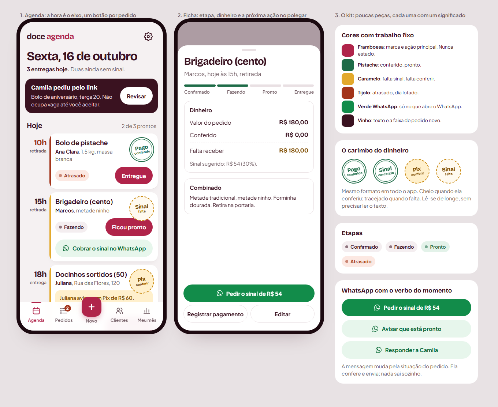

# Doce Agenda — auditoria de produto, UI/UX e frontend

16/10/2026 · versão no ar `c845cfce` (commit `1064ca0`) · demonstração em https://www.lucast.app/demo/

Este relatório não alterou o app nem publicou nada. Scripts e capturas brutas ficam fora do repositório, em `Documents/doce-agenda-auditoria/`. As imagens usadas aqui estão em `img/`. O protótipo está em `prototipo/index.html`.

---

## 0. Resumo para decidir

**Diagnóstico em uma frase:** o Doce Agenda tem regras de negócio maduras e honestas, mas a interface parece um modelo de SaaS pintado de rosa. Isso não se resolve com mais ícones. O problema é **hierarquia**, **densidade** e **duas identidades visuais competindo**.

Nota de maturidade (minha escala, 1 a 5):

| Dimensão | Nota | Por quê, em uma linha |
|---|---|---|
| Regras e confiança | 4,5 | Só conta dinheiro conferido, pedido do link não reserva vaga, textos honestos. Raro e valioso. |
| Arquitetura de informação | 3 | As abas fazem sentido, mas toda tela abre com cabeçalho, frase de efeito e dica antes do conteúdo. |
| Design visual | 2,5 | Competente, mas genérico: cartões brancos iguais, excesso de pílulas, títulos em maiúsculas espaçadas, "→" nos botões. |
| Consistência / design system | 2 | Duas camadas de CSS (Glacê com 100 KB, por baixo da vnext com 38 KB), 4 fontes, 2 verdes, 2 escalas de raio, 2 sistemas de botão. |
| Ergonomia mobile | 3,5 | Toques bons e barra com "Novo" central. Porém só cabem 2,5 pedidos por tela. |
| Acabamento técnico | 2,5 | Leve e rápido, sem erros de JavaScript, mas com defeitos visíveis: cartão cortado a 360 px, valor quebrado em Meu mês, WhatsApp na demo, 170 problemas de contraste. |

**Minha recomendação:** a direção **"Comanda"**, vista na figura abaixo. Ela tem três ideias centrais:

1. **A hora vira o eixo da Agenda.**
2. **Cada pedido tem um único botão.**
3. **O dinheiro tem forma própria (o carimbo)**: cheio quando foi conferido, tracejado quando falta.

O verde do WhatsApp só aparece em ações que abrem o WhatsApp, e cada uma com o verbo do momento ("Pedir o sinal de R$ 54").

**Onde eu discordo das suas impressões:**

- **"Ícones mais expressivos":** concordo só em parte. Hoje o app usa 13 ícones em 15 lugares, e os que aparecem são decorativos (o relógio repete em todo cartão). Falta ícone **com significado** (WhatsApp, pagamento, entrega/retirada), não ícone a mais.
- **"Badges bem projetados":** o problema é o oposto. O cartão das 10h carrega quatro rótulos (Atrasado, Sinal conferido, Pronto, Retirada). Proponho **menos badges** e um único sinal forte para o dinheiro.
- **"Cards mais refinados":** sim, mas refinado aqui quer dizer **mais baixo e mais denso**, não mais enfeitado.
- **"WhatsApp com ícone oficial, fundo verde e mensagens contextualizadas":** concordo totalmente. É o ganho de maior valor por esforço desta auditoria, desde que o verde fique só nessas ações.

---

## 1. Ferramentas: o que foi instalado, o que já existia, o que foi usado

| Recurso | Situação | Uso real |
|---|---|---|
| Plugin `frontend-design` (claude-plugins-official) | **Instalado** só neste projeto (`--scope project`) | Usado para a direção estética e para checar os "tiques de modelo" (seção 3.4) |
| Skill `web-design-guidelines` (vercel-labs/agent-skills) | **Instalada** em `.claude/skills/` deste projeto | Regras baixadas e aplicadas por busca no código (seção 5.3) |
| Playwright 1.62.1 | **Já existia** no projeto | Capturas a 390 px pelo agente principal e auditoria automática em 4 larguras (seção 5) |
| `@axe-core/playwright` 4.10.2 | **Instalado** na pasta isolada `doce-agenda-auditoria/` | Acessibilidade automática (seção 5) |
| Navegador embutido do app | Já existia | Inspeção rápida; as capturas oficiais foram feitas por Playwright, porque o painel distorce o zoom |
| Subagentes | Haiku (inventário do design system), Sonnet (auditoria automática) | O julgamento visual e as conclusões são meus, com as capturas vistas pessoalmente |

A instalação deixou três arquivos sem commit no repositório: `.claude/settings.json` (liga o plugin no projeto), `.claude/skills/web-design-guidelines/` e `skills-lock.json`. Decida se ficam.

---

## 2. Os 8 fatores que mais derrubam a qualidade percebida

Ordenados pelo efeito na sensação de "produto maduro".

### F1. Duas identidades visuais empilhadas
- **Contexto.** `public/style.css` (cerca de 100 KB, visual Glacê) continua carregado, e `public/ui/vnext.css` o sobrescreve tela por tela.
  - `tokens.css` define cerca de 18 cores, mais duas escalas de raio (`--r-*` 8/12/16/24 e `--radius-*` 16/24/28).
  - `vnext.css` traz outras 15 cores `--vn-*`, um raio de 20 e cerca de 55 hexadecimais literais fora dos tokens.
  - Há dois verdes (`#2e6a46` e `#006947`) e dois vinhos (`#2b1a2c` e `#4a1525`).
  - Fontes: Fredoka e Figtree ainda são pré-carregadas no `index.html`, e Outfit e Plus Jakarta Sans vêm por cima.
  - O `BRAND.md` descreve Fredoka/Figtree e raios 12/16/24, ou seja, contradiz o que está no ar.
- **Consequência.** Cada tela tem pequenas diferenças de raio, peso, sombra e cor. O usuário não sabe nomear, mas sente "remendo". Também se baixam fontes que não aparecem.
- **Solução.** Um arquivo de tokens só, duas famílias de fonte, uma escala de raio com três valores. Depois, retirar o Glacê com comparação de capturas. (Fase 1 e Fase 5 da estratégia.)

### F2. Hierarquia plana e "sopa de pílulas"
- **Contexto.** Veja `img/atual-agenda-hoje.png`. O primeiro cartão tem relógio + "10h" + "· Retirada" + pílula "Atrasado" + pílula "Sinal conferido" + miniatura "B" + nome + produto + detalhes com " · " + seta ">" + pílula "Pronto" + botão "Marcar entregue →". São 12 elementos competindo, e três deles com o mesmo formato de pílula.
- **Consequência.** Com pressa, o olho não acha o que importa: que horas, o quê, já está pago, o que faço agora.
- **Solução.** O cartão Comanda tem quatro camadas fixas:
  1. a hora, na coluna da esquerda;
  2. o produto, como título;
  3. cliente e detalhe, numa linha de apoio;
  4. uma etapa discreta e **um** botão.

  O dinheiro vira o carimbo no canto. A miniatura com letra sai (só fica foto real). A seta ">" sai, porque o cartão inteiro já é tocável.

### F3. A primeira tela não mostra trabalho
- **Contexto.** Em `img/atual-agenda-dobra.png` (390×844), a primeira tela inteira tem faixa da demo (cerca de 220 px), data, título, resumo e "Experimente em 1 minuto", e nenhum pedido. Pedidos, Clientes, Meu mês e Ajustes repetem o padrão: rótulo colorido em cima ("Do orçamento à entrega"), título, frase de efeito ("O combinado de cada cliente, sempre à mão."), caixa "Dica" e só depois o conteúdo. Em Pedidos (`img/atual-pedidos.png`), a lista de 21 pedidos começa abaixo da dobra.
- **Consequência.** Parece uma página de marketing dentro do app. Na cozinha, ela abre o app e precisa rolar para ver o próprio trabalho.
- **Solução.**
  - Faixa da demo com uma linha (44 px) e "Mais" recolhido.
  - Sem frase de efeito nas telas internas.
  - Dicas só na primeira visita e depois num "?" pequeno.
  - Título de tela com no máximo 28 px.
  - Meta: pelo menos um pedido visível na primeira tela da Agenda, mesmo na demo.

### F4. Tiques de modelo pronto
Estes são os sinais que o próprio guia `frontend-design` aponta como "cara de modelo pronto". Todos aparecem no app:

| Tique | Onde | Quantidade |
|---|---|---|
| Rótulo em MAIÚSCULAS espaçadas | `.vn-eyebrow`, `.upcoming-label`, `.next-action-card h2`, `.detail-eyebrow` (`vnext.css:37,171,197,207`) e "PEDIDOS / VENDIDO / RECEBIDO" em Meu mês | 5 regras de CSS |
| "→" no fim de botões | "Marcar entregue →", "Ficou pronto →", "Todos os pedidos →" (`app.js`) | 6 |
| Informações soltas unidas por " · " | "10h · Retirada", "Todos os dias · até 3 por dia" | 43 trechos em `app.js` |
| Miniatura com a inicial | "B" e "D" nos cartões e letra gigante na vitrine | em todo cartão sem foto |
| Frase de efeito sob o título | Pedidos, Meu mês, Clientes | 4 telas |

**Solução:** frases curtas e estruturadas ("Retirada às 10h"), rótulos em caixa normal, seta só onde há navegação real e nenhuma letra no lugar de imagem.

### F5. Dinheiro sem cuidado de tipografia
- **Contexto.**
  - Em Meu mês a 390 px, **"R$ 1.800," numa linha e "00" na outra** (`img/atual-meu-mes.png`).
  - Na ficha, o sinal vazio aparece como um traço enorme "—" e o saldo como "Ainda não conferido", em letra de título (`img/atual-ficha-pedido.png`).
  - `vnext.css` não usa `tabular-nums` (0 ocorrências), então os números mudam de largura.
- **Consequência.** Dinheiro é o tema de maior ansiedade da confeiteira. Valor quebrado ou ambíguo corrói a confiança.
- **Solução.** Valores com `white-space: nowrap` e `tabular-nums`, e tamanho que se ajusta (`clamp`). Na ficha, um bloco "Dinheiro" em três linhas: valor do pedido, conferido, **falta receber**, este último em caramelo. Ver o protótipo, tela 2.

### F6. Iconografia sem significado
- **Contexto.** `public/ui/icons.js` tem 13 ícones (calendar, inbox, wallet, cake, arrow, left, right, check, clock, plus, info, message, link), usados 15 vezes. Ficam de fora justamente os conceitos centrais: WhatsApp, Pix/pagamento, entrega (moto) × retirada (sacola), produção (batedor), cliente. O "×" de fechar ainda é texto em uma janela (`index.html`, `#refuse-dialog`, já corrigido na última entrega) e "!" é texto no aviso de erro.
- **Solução.** Um conjunto de cerca de 24 ícones de traço único (base Lucide, licença ISC, servida localmente), cada um ligado a um conceito do domínio. A regra é: ícone só onde ajuda a reconhecer, nunca para enfeitar.

### F7. Contadores e sinais que não dizem nada
- **Contexto.** A aba Pedidos mostra **21** no círculo (total de pedidos). Esse número não pede ação.
- **Solução.** O contador passa a mostrar só o que precisa dela: pedidos do link para revisar + Pix para conferir. Na demo, isso daria 2. Esse número tem significado e pode usar a cor de atenção.

### F8. A vitrine sem foto parece inacabada
- **Contexto.** Em `img/atual-vitrine-previa.png`, produto sem foto vira um quadrado de 340 px com uma letra "B". É a tela que a **cliente** vê, a vitrine da confeiteira.
- **Solução.** Sem foto, o cartão fica só com texto: nome, "a partir de" e categoria, em lista compacta. Com foto, a grade atual.

---

## 3. Descobertas por tela e fluxo

### 3.1 Landing (`/`)
- **Funciona:**
  - A frase "Saiba o que fazer, entregar e cobrar em cada dia da semana" é concreta.
  - O botão "Experimentar sem cadastro" é claro.
  - A demonstração animada do link é o melhor momento do site.
- **Enfraquece:**
  - O título destaca metade da frase em cor, o tique de "uma parte colorida".
  - O celular do topo mostra a faixa da semana, que é o elemento menos característico. Deveria mostrar o **carimbo de dinheiro conferido** ou o cartão de pedido.
  - Os três checks ("Grátis no piloto / Sem cartão / Nada para instalar") quebram em duas linhas a 390 px.
- **Prioridade:** P3. A landing não é o gargalo de agora.

### 3.2 Agenda (tela principal)
- **Funciona:**
  - Ordem nova (pedidos novos → hoje → semana → falta cobrar).
  - "Novo" no centro.
  - "Atrasado" em tijolo.
  - "Falta cobrar".
- **Enfraquece:** F2 e F3.
  - Cartões com cerca de 250 px de altura: cabem 2,5 por tela a 390 px.
  - O resumo do topo ("3 para entregar · 2 faltam o sinal") é bom conteúdo com peso fraco.
  - O painel vinho "Resumo financeiro" repete o Meu mês no celular.
- **Proposta:** protótipo, tela 1.
  - Coluna de horário, cartão Comanda com cerca de 140 px e um botão.
  - "Falta cobrar" como **lista densa com valor à direita**, em vez de cartões.
  - Painel financeiro só no computador (coluna lateral). No celular, ele sai, porque "Falta cobrar" e Meu mês já cobrem o assunto.

### 3.3 Ficha do pedido
- **Funciona:**
  - Botão de próximo passo no topo.
  - Aviso "o sinal só conta quando você confirma".
  - Rodapé fixo com ações.
- **Enfraquece:**
  - Cabeçalho vinho com "FICHA DA ENCOMENDA" em maiúsculas.
  - O foco vai para o "×" ao abrir, e o anel verde chama atenção para o botão errado.
  - As pílulas "Retirada" e telefone parecem botões, mas não são.
  - Bloco "SINAL" com um traço "—" de 48 px.
  - "Saldo a receber: Ainda não conferido" em letra de título.
  - Três botões grandes no rodapé (cerca de 210 px de 844).
- **Proposta:** protótipo, tela 2.
  - Barra de etapas com quatro passos.
  - Bloco "Dinheiro" em três linhas.
  - Rodapé com **uma** ação verde contextual ("Pedir o sinal de R$ 54") e duas secundárias.
  - O foco ao abrir vai para o título.

### 3.4 Pedidos
- Primeira tela sem pedidos (F3).
- Quando há busca, os filtros por etapa ficam numa faixa com rolagem lateral. Funciona, mas "Todos 21" em framboesa cheio pesa mais que o conteúdo.
- **Proposta:** cabeçalho de uma linha (título + busca em ícone), filtros com um realce sutil e lista de comandas compactas agrupadas por data.

### 3.5 Novo pedido
- **Funciona:** 5 campos à vista, atalhos "Hoje/Amanhã", "R$" dentro do campo.
- **Enfraquece:**
  - O foco automático no nome abre o teclado na hora, o que esconde metade do formulário. Isso é bom para quem vai digitar, ruim para quem quer olhar primeiro. **Manter** com teclado: é o uso mais comum.
  - "Situação" fica abaixo da dobra, e ela muda as regras (data obrigatória).
  - O seletor nativo de data mostra "dd/mm/aaaa".
- **Proposta:** "Situação" como um controle de duas opções (**Confirmado** | **Orçamento**) logo abaixo de "O quê?", porque decide o resto do formulário.

### 3.6 Meu mês
- Defeito do valor quebrado (F5).
- Quatro rótulos em maiúsculas.
- O cartão "Vendido" em vinho cheio compete com "Recebido", que é o número que importa pela regra do produto.
- **Proposta:** "Recebido (conferido)" como número herói. "Vendido" e "A receber" ficam menores, em linha.

### 3.7 Clientes
- "Datas que se repetem" é uma ótima ideia de produto e está bem escrita.
- Lista sem densidade.
- Telefone e "0 pedidos" ligados por " · ".
- **Proposta:** lista com avatar de iniciais **pequeno** (32 px; aqui identifica pessoas, então faz sentido), última compra e botão WhatsApp verde só no ícone.

### 3.8 Ajustes
- Bons cartões que abrem e fecham, com resumo de uma linha.
- "Avançado" está sem a seta de abrir, o que destoa dos outros. Defeito da entrega de 16/10.

### 3.9 Vitrine da cliente (`/encomenda/`)
- O cabeçalho com monograma e a "Próxima data livre" funcionam.
- F8: sem foto, vira letra gigante.

### 3.10 Situações reais testadas mentalmente sobre as telas
| Situação | Hoje | Com a proposta |
|---|---|---|
| Anotar pedido com a mão suja | Toque no "Novo" central, 5 campos, OK | Igual, com "Situação" antes da data |
| Cliente pede orçamento pelo link | Faixa vinho → revisão com "Aceitar pedido / Ainda vou passar o preço / Recusar" | Igual (já resolvido) |
| Cobrar o sinal | Abrir o pedido → "Abrir conversa com o resumo" (texto genérico) | Na própria Agenda: "Cobrar o sinal no WhatsApp" com o valor do sinal na mensagem |
| Conferir Pix avisado | Abrir o pedido → rolar → pagamento → conferir | Botão "Conferi o Pix" no próprio cartão |
| Dia com 6 encomendas | 2,5 cartões por tela, 3 rolagens | Cerca de 5 comandas por tela |
| Achar "quanto falta receber hoje" sob pressão | Painel vinho no fim da Agenda | "Falta cobrar" com total no título |

---

## 4. Inconsistências encontradas (inventário)

- **Botões:** `.button` / `.button-primary` / `.button-quiet` / `.button-small` (`style.css:22-25`), além de `.vn-btn` com `.primary/.secondary/.small` (`vnext.css:22-29`) e `<wa-button>` no formulário. São três implementações do mesmo componente.
- **Badges:** `.status-pill` (`style.css`) × `.vn-badge` (`vnext.css`).
- **Cartão de pedido:** `.order-row` (ainda usado no exemplo do primeiro uso) × `.vn-order`.
- **Avisos:** `.notice`, `.vn-note`, `.pending-banner`, `.request-banner`, `.tip`.
- **Raios em uso:** 8, 12, 13, 14, 16, 18, 20, 24, 28, 30, 999.
- **`!important`:** 15 no `style.css`, sinal de briga de especificidade.
- **`@media`:** 43 no `style.css` e 12 no `vnext.css`.

---

## 5. Problemas verificados por teste ou inspeção

### 5.1 Defeitos (corrigir antes de qualquer mudança visual)

| # | Gravidade | Onde | O que acontece | Evidência | Correção |
|---|---|---|---|---|---|
| D0 | **Grave** | Cartões de pedido a 360 e 390 px (Pedidos, Agenda e o fundo de todas as janelas abertas sobre Pedidos) | A linha de cima do cartão (data · hora · modo + selo de pagamento) não quebra linha (`.vn-time` com `white-space: nowrap`) e empurra o cartão até 457 px numa tela de 360 px. Como o `html` tem `overflow-x: clip`, não aparece rolagem: **o valor e o selo de pagamento ficam cortados fora da tela**. Em Pedidos, as datas ("qua, 5 nov ·") pioram o quadro; na Agenda, o selo "Atrasado" da entrega de 16/10 agravou. | `img/defeito-cartao-cortado-360.png`; o script mediu a borda direita do cartão em 457 px com tela de 360 | Deixar a linha quebrar (`flex-wrap: wrap`), mover a data para a linha de apoio e o selo para o canto (como na Comanda) |
| D1 | **Grave** | Ficha do pedido na **demo** | "Abrir conversa com o resumo" aparece em pedidos fictícios (Marcos, `(11) 90000-0108`) e abre o WhatsApp de um número que pode existir. **Introduzido por mim na entrega de 16/10:** a checagem `sampleOrder()` não cobre os pedidos da demo. | `img/atual-ficha-pedido.png` | Esconder o link quando `DoceApi.mode` for local/demo. Uma linha em `whatsAppLink()` (`app.js`). |
| D2 | Alto | Meu mês, 390 px | Valor quebra no meio ("R$ 1.800," / "00") | `img/atual-meu-mes.png` | `white-space: nowrap` + `font-size: clamp()` nos `.stat-value` de `#view-month` |
| D3 | Médio (acessibilidade) | Cartões da Agenda e de Pedidos | `<article role="button">` contém outro `<button>` (próximo passo): interativo dentro de interativo. Leitor de tela e teclado se confundem. | `app.js` (`agendaCardMarkup`, 2 ocorrências de `role="button"`) | O cartão vira `<article>` com um link/botão "Abrir" cobrindo a área (padrão do cartão clicável), e o botão de etapa fica fora dele |
| D4 | Médio | Ficha | Foco inicial no "×" mostra anel verde grosso ao abrir | `img/atual-ficha-pedido.png` | Focar o título (`tabindex="-1"`) |
| D5 | Baixo | Barra de baixo | Contador "21" de Pedidos não pede ação | `img/atual-pedidos.png` | Contar só o que pede revisão ou conferência |
| D6 | Baixo | Ajustes | "Avançado" sem a seta dos outros cartões (entrega de 16/10) | `img/atual-ajustes.png` | Reusar o estilo de `.settings-card > summary` |
| D7 | Baixo | App | Sem link "Pular para o conteúdo"; Fredoka e Figtree pré-carregadas embora a vnext troque as fontes (conferir se algum canto ainda usa) | `index.html` | Adicionar o link; tirar os `preload` |

### 5.2 Auditoria automatizada (Playwright + axe, 360/390/768/1440)

Feita por script na demo publicada: 128 combinações de tela × largura, 76 delas com axe-core. São 59 capturas em `Documents/doce-agenda-auditoria/shots/`, com os dados completos em `results/checks.json`. Encerrei o agente antes de ele medir a contagem de toques por tarefa; essa parte ficou sem número.

| Checagem | Resultado |
|---|---|
| Rolagem ou corte lateral | **19 de 128** combinações passam da largura da tela: 13 a 360 px e 6 a 390 px. Causa única: D0. A 768 e 1440 px, nenhuma. |
| Acessibilidade (axe, WCAG A/AA) | 2 tipos de violação, ambos *serious*. **Contraste** em 170 elementos: principalmente a data dos pedidos entregues (`.vn-day-label`, apagada pela opacidade do cartão entregue) e a contagem dos dias da semana (`.day-count`). **Interativo aninhado** em 48 elementos (D3). |
| Alvos de toque menores que 44 px (360/390) | 33 tipos. Os relevantes: os filtros de Pedidos ("Todos 21", "Novos 2"…) com **40 px** de altura, o logo/link "ir para Hoje" (40 px), "Pular" das boas-vindas (42 px), "Mostrar" senha no cadastro (40 px) e links de rodapé da vitrine (19 px de altura). |
| Letra menor que 12 px | No app, só "(até 3)" em Ajustes (11,7 px). Na landing, as imitações de celular usam 4 a 11 px; é desenho, aceitável, mas os textos fora do celular ("A agenda avisa antes", 11 px) não deveriam. |
| Janelas | Fecham com Esc, com o "×" e tocando fora, e o foco volta ao botão de origem. ✓ Porém **o fundo rola por trás** com a janela aberta (formulário e ficha), e o foco inicial da ficha vai para o "×" (D4). |
| Foco pelo teclado | Anel verde de 3 px visível em todos os elementos testados ✓ |
| Erros de JavaScript | 0 ✓ |
| Avisos do navegador | "Fredoka.ttf e Figtree.ttf pré-carregadas e não usadas", em toda página do app (confirma D7) |
| Terceiros | `static.cloudflareinsights.com` (análise da Cloudflare) carrega em toda página. Pendência já conhecida, que contraria a política de privacidade. |
| `/p/inexistente` | Mostra a página de "não encontrado"; o 404 do servidor é esperado ✓ |
| `/app/` sem sessão | Vai para `/cadastro/` ✓ |
| Links do WhatsApp na demo | `wa.me/<número>?text=` aparece na ficha de pedidos fictícios (confirma D1), além do link da ficha da cliente |

**Desempenho** (390 px, sem cache):

| Página | Rede normal | 4G lento (400 ms, 1,6 Mbps) | Peso | Pulo de layout (CLS) |
|---|---|---|---|---|
| Landing | LCP 1,3 s | LCP 3,4 s | 354 KB, 56 KB de JS, 18 pedidos | 0,001 ✓ |
| Demo | LCP 1,1 s | LCP 3,0 s | 388 KB, 134 KB de JS, 21 pedidos | **0,136** ✗ (bom é até 0,1) |

O app é leve. O pulo de layout da demo vem do conteúdo montado depois do carregamento (faixa, boas-vindas, troca de fontes). Reservar espaço e tirar os preloads inúteis resolve.

### 5.3 Regras de interface (Vercel Web Interface Guidelines) checadas no código

| Regra | Situação |
|---|---|
| `transition: all` | ✓ não há |
| Zoom bloqueado (`user-scalable=no`) | ✓ não há |
| `theme-color` | ✓ presente |
| `touch-action: manipulation` | ✗ ausente (atraso de toque duplo em alguns navegadores) |
| `overscroll-behavior: contain` nas janelas | ✗ ausente: ao rolar a ficha até o fim, a página por baixo pode rolar junto (não medido) |
| `tabular-nums` em números | ✗ ausente no `vnext.css` (existe 14× no Glacê antigo) |
| `text-wrap: balance` em títulos | ✗ ausente |
| Link de pular para o conteúdo | ✗ ausente |
| `outline: none` | ⚠ 3 ocorrências; conferir se há substituto (`:focus-visible` existe no vnext) |
| Interativo aninhado | ✗ ver D3 |

---

## 6. Direção estética recomendada: "Comanda"

**De onde vem:** do próprio ofício. A confeiteira trabalha com **comandas** (a ficha do pedido presa na bancada), **etiquetas** de caixa e o **carimbo** de pago. O Doce Agenda já tinha o carimbo e o perdeu na troca para a vnext, onde virou uma pílula verde. Proponho devolvê-lo como a única peça ousada do produto, porque ele carrega a regra mais importante: **só conta o que foi conferido**.

**Princípios**
1. **A hora é o eixo.** Na Agenda, a coluna da esquerda é o tempo, em fonte de display grande. O resto se alinha a ela.
2. **Um pedido, um botão.** Cada cartão tem exatamente uma ação principal com o verbo da próxima etapa. O cartão inteiro abre a ficha.
3. **O dinheiro tem forma.** Um único selo redondo, levemente torto: **cheio** (pistache) = conferido; **tracejado** (caramelo) = falta ou falta conferir. A forma se lê de longe, sem ler o texto. O texto continua presente (regra de acessibilidade).
4. **Cor é significado.**
   - Framboesa: marca e ação principal, nunca estado.
   - Pistache: ok. Caramelo: falta. Tijolo: atraso ou lotado.
   - Verde WhatsApp: só em botões que abrem o WhatsApp, sempre com o ícone, nunca em selo ou rótulo. Isso evita confusão com o pistache.
5. **Silêncio em volta.** Fundo "farinha" neutro (`#f5f1f2`) no lugar do rosa em toda a tela. Sem frases de efeito, sem maiúsculas espaçadas, sem setas decorativas.

**Tokens propostos (7 cores)**

| Nome | Hex | Trabalho |
|---|---|---|
| Vinho | `#3a1220` | texto, títulos, faixa de pedido novo |
| Framboesa | `#b0244a` | marca e ação principal |
| Farinha | `#f5f1f2` | fundo |
| Açúcar | `#ffffff` | superfícies |
| Pistache | `#1e6b47` / fundo `#e3f2e9` | conferido, pronto |
| Caramelo | `#7f4d00` / fundo `#fff0cc` | falta sinal, falta conferir |
| Tijolo | `#a3341a` / fundo `#fce8e2` | atrasado, lotado |
| (WhatsApp) | `#128c4a` | só ações do WhatsApp |

**Tipografia:** **Bricolage Grotesque** para display (horários, valores, títulos), por ser mais quente e com personalidade, e porque **já está no projeto** (`@fontsource/bricolage-grotesque`, usada na vitrine). **Plus Jakarta Sans** para todo o resto, com `tabular-nums` nos números. Saem Outfit (parecida demais com a Jakarta: duas geométricas não fazem contraste), Fredoka e Figtree. Escala: 12 / 14 / 16 / 18 / 22 / 28 / 34.

**Forma:** raio 18 nos cartões e 14 nos controles, pílula só em botão. Uma sombra só (`0 6px 18px -10px` vinho a 15%). Filete lateral de 4 px no cartão com a cor do estado do dinheiro.

**Movimento:** um único momento coreografado, o **carimbo batendo** quando ela marca "Conferi" (já existia como `@keyframes carimbo`). Fora isso, só transições que respondem ao toque. Movimento reduzido respeitado.

**O que o protótipo NÃO resolve ainda (honestidade):** o texto pequeno dentro do selo tem 9 px e fere a regra de 12 px mínimos. Na implementação, o selo leva só a palavra grande ("Pago", "Sinal", "Pix"), e o complemento ("conferido", "falta") vai no texto acessível e na linha de apoio. Também falta validar o selo com quem tem daltonismo: a diferença cheio × tracejado foi pensada para isso, mas não foi testada.

---

## 7. Mudanças mais importantes, por impacto e prioridade

| Prio | Mudança | Impacto | Esforço | Risco |
|---|---|---|---|---|
| **P0** | Defeitos D0, D1, D2, D6 (cartão cortado a 360 px, WhatsApp na demo, valor quebrado, Avançado) + contraste da data dos entregues | **Muito alto** (o cartão cortado esconde o valor) | Baixo, 1 a 2 h | Baixo |
| **P1** | Fundação: tokens únicos, 2 fontes, escala de raio, `tabular-nums`, ícones | Alto (consistência em tudo) | Médio | Médio: mexe em todas as telas; exige comparação de capturas |
| **P1** | Cartão Comanda + selo de dinheiro (Agenda e Pedidos) | **Muito alto**: é o que ela mais vê | Médio | Médio: o teste `test-payment-stamps` usa `.vn-badge.green`; atualizar |
| **P1** | WhatsApp contextual (verbo e mensagem por situação, botão verde com ícone) | **Muito alto** (valor prático) | Baixo a médio | Baixo; sem envio automático, sem API |
| **P2** | Primeira tela útil: faixa da demo de uma linha, sem frases de efeito, dicas só na primeira vez | Alto | Baixo | Baixo |
| **P2** | Ficha do pedido: etapas, bloco Dinheiro, foco no título, 1 ação verde | Alto | Médio | Médio |
| **P2** | Contador da barra = só o que pede ação; "Situação" como chave no formulário | Médio | Baixo | Baixo |
| **P2** | D3: cartão sem interativo aninhado | Médio (acessibilidade) | Médio | Médio: os testes clicam em `[data-open-order]` |
| **P3** | Meu mês com "Recebido" como herói | Médio | Baixo | Baixo |
| **P3** | Vitrine sem foto em lista compacta | Médio (cliente final) | Baixo | Baixo |
| **P3** | Retirar o Glacê (`style.css`) e atualizar o BRAND.md | Médio (manutenção) | Alto | Alto sem comparação de capturas |
| **P4** | Landing: celular do topo mostrando o carimbo | Baixo | Baixo | Baixo |

**Mensagens de WhatsApp por situação** (ela confere e envia; nada sai sozinho):

| Situação do pedido | Botão | Começo da mensagem |
|---|---|---|
| Confirmado, falta sinal | "Pedir o sinal de R$ 54" | "Oi, Marcos! Seu pedido de Brigadeiro (cento) para hoje às 15h está confirmado. Para garantir, o sinal é R$ 54. Pix: …" |
| Orçamento | "Mandar o orçamento" | "Oi, Camila! O Bolo de aniversário para terça fica em R$ …" |
| Pronto, retirada | "Avisar que está pronto" | "Oi, Ana Clara! Seu Bolo de pistache está pronto para retirar às 10h." |
| Entregue com saldo | "Cobrar R$ 55" | "Oi, Roberta! Obrigada pela encomenda. Ficou faltando R$ 55 da Torta de limão. Pix: …" |
| Solicitação recusada | "Avisar a cliente" | (mensagem educada já existente) |

---

## 8. Arquivos e componentes que mudariam

| Arquivo | O que muda |
|---|---|
| `public/ui/vnext.css` | Vira a única folha do app: tokens novos, componentes `comanda`, `selo`, `etapa`, `zap`, `lista` |
| `public/tokens.css` | Reduzido aos tokens usados também por landing, vitrine e cadastro, ou unificado |
| `public/style.css` | Removido aos poucos (Fase 5) |
| `public/index.html` | Tira os `preload` de Fredoka/Figtree; link de pular; faixa da demo compacta; janelas com `overscroll-behavior` |
| `public/ui/icons.js` | Conjunto de cerca de 24 ícones do domínio (WhatsApp, pix, moto, sacola, batedor…) |
| `public/app.js` | `agendaCardMarkup` (cartão), `paymentBadge` e `statusBadge` (selo e etapa), `nextStepButton`, ficha (`showOrderDetail`, cerca da linha 790), `makeWhatsAppSummary` (mensagens por situação) e `whatsAppLink` (D1), `toCollectMarkup` (lista densa), cabeçalhos de Pedidos/Clientes/Meu mês/Ajustes, contador da barra |
| `public/encomenda/order.js` e `order.css` | Cartão sem foto |
| `BRAND.md` | Reescrito para a direção Comanda (hoje contradiz o app) |
| `scripts/test-payment-stamps.mjs`, `test-inbox.mjs`, `capture-screens.mjs` | Seletores novos do selo e do cartão |

---

## 9. Estratégia de implementação

Uma fase por vez, cada uma com commit próprio, `npm run check`, capturas antes e depois em 360/390/768/1440 e publicação só depois de conferida.

- **Fase 0 — Defeitos (P0).** D0, D1, D2, D6 e contraste dos entregues. De 1 a 2 horas; publicar logo.
- **Fase 1 — Fundação, sem mudar telas de lugar.**
  - Tokens novos em `vnext.css` (as variáveis antigas apontam para as novas, para não quebrar nada).
  - Bricolage + Jakarta, sem preload de fontes não usadas.
  - Escala de raio, `tabular-nums`, `touch-action`, `overscroll-behavior`.
  - Ícones novos.
  - Critério: capturas mudam só em cor, fonte e raio, nunca em posição.
- **Fase 2 — Comanda + selo** na Agenda e em Pedidos. Atualizar testes de carimbo e caixa de entrada.
- **Fase 3 — WhatsApp contextual + ficha do pedido.** Mensagens por situação, ação verde única, bloco Dinheiro, etapas, foco no título.
- **Fase 4 — Telas secundárias.** Cabeçalhos de uma linha, dicas só na primeira vez, Meu mês com "Recebido" herói, contador da barra, "Situação" como chave.
- **Fase 5 — Faxina.** Retirar o Glacê do `style.css` com comparação de capturas pixel a pixel; BRAND.md novo.
- **Fase 6 — Vitrine e landing.**

**Antes da Fase 2:** mostrar o protótipo (ou o app com a Fase 1) a **uma confeiteira real** por 15 minutos, com 4 tarefas: anotar pedido, cobrar sinal, conferir Pix, ver o que falta hoje. É barato e é o que mais reduz risco. Isso nunca foi feito.

---

## 10. Critérios para verificar a qualidade da implementação

**Mensuráveis por script (Playwright):**
- Agenda a 390×844, na demo, com as boas-vindas fechadas: **pelo menos 1 pedido na primeira tela** e **pelo menos 4 comandas por tela** na lista do dia (altura do cartão até 150 px).
- Cada cartão: **1** botão, **até 1** etapa, **1** selo de dinheiro (quando aplicável), **0** setas "→".
- CSS do app: **2** famílias de fonte, **até 8** tamanhos, **3** raios, **0** `text-transform: uppercase`, **0** cores literais fora dos tokens no CSS novo.
- Valores em R$: **nunca quebram linha** de 320 a 1440 px (checar `getClientRects().length === 1`).
- axe-core: **0** violações *serious/critical* nas telas principais.
- Toques: **≥ 44 px** em tudo e **≥ 48 px** nas ações principais; sem rolagem lateral de 320 a 1440.
- Tarefas, em toques a partir da Agenda: cobrar sinal no WhatsApp **≤ 1**; conferir Pix avisado **≤ 2**; avançar etapa **1**.
- Na demo, nenhum `href` para `wa.me` com número (D1).

**Julgamento humano:**
- Teste de 5 segundos: mostrar a Agenda por 5 s e perguntar "o que você tem que fazer agora e o que falta cobrar?". Ela precisa acertar as duas.
- Uma confeiteira real faz as 4 tarefas sem ajuda.
- Comparação lado a lado de antes e depois (capturas em `img/`), com "parece um app de verdade?" respondido por alguém de fora.

---

## Limitações desta auditoria
- **Não testado:** conta real logada, iPhone/Safari, aparelho físico, leitor de tela real (só axe automático), daltonismo. Também não abri o WhatsApp de verdade nem testei o cadastro (por regra, nada foi enviado).
- O julgamento estético é meu; as capturas são evidência, não prova de qualidade.
- O protótipo é um conceito estático em HTML, não interativo, e usa fontes do Google só nele.
